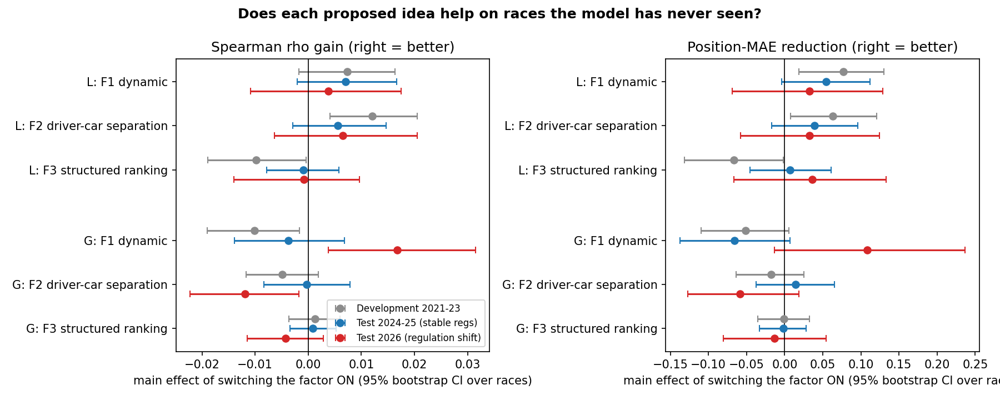
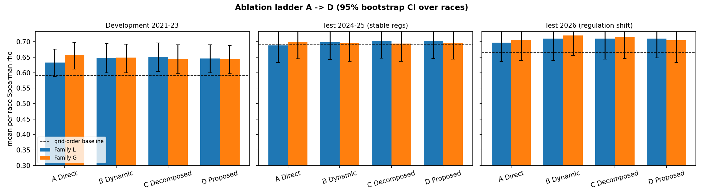
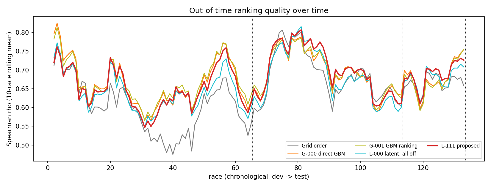
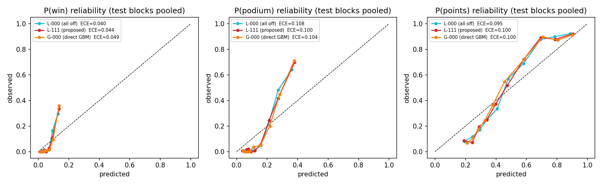
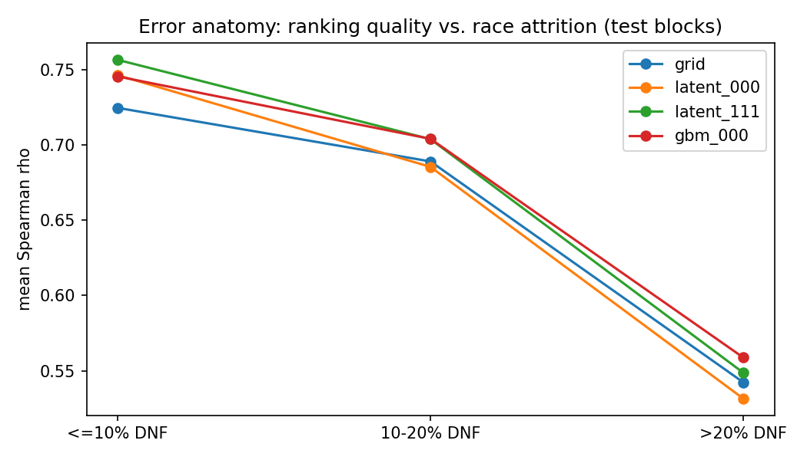
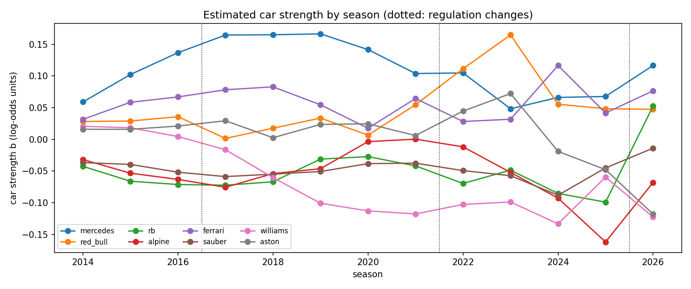
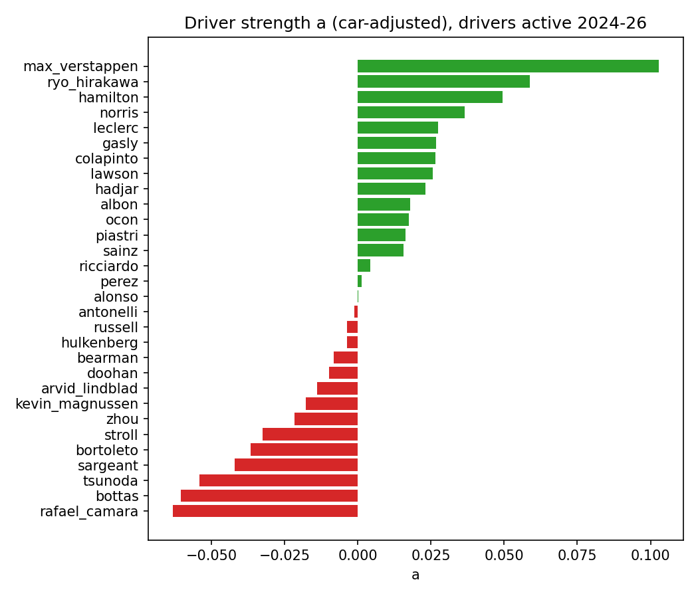
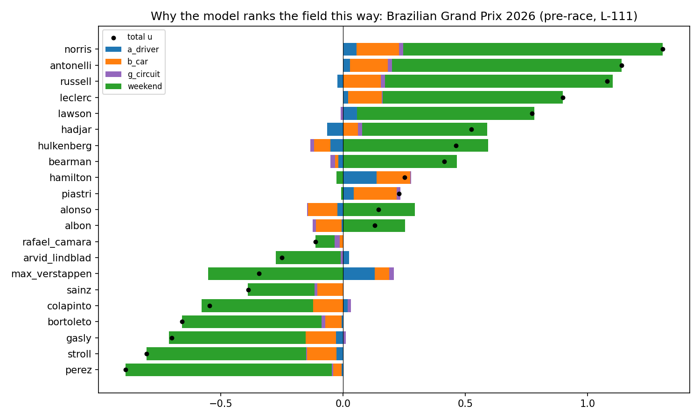
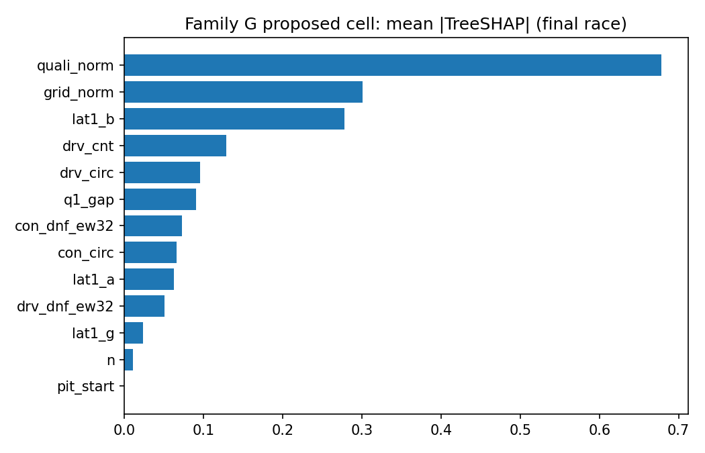

# PitLane — results report

_Generated from `results/leaderboard.csv`; configs frozen on dev (hash `5980a1f6ddba`) before the test blocks were run. Every number is a mean over races of per-race metrics; uncertainty is a bootstrap over races._

**Primary research question:** can explicit separation of car, driver and circuit effects (with dynamic weighting and structured ranking) improve out-of-time F1 race-order prediction?

## 1. Leaderboards
Higher is better for rho / NDCG / hits; lower for MAE and log-loss. Cell code = F1 dynamic, F2 decomposed, F3 ranking (e.g. `latent_111` = proposed model, `000` = all off).

### Development 2021-23
| model | rho | MAE | rho (finishers) | NDCG@10 | win hit | podium overlap | win logloss | races |
|---|---|---|---|---|---|---|---|---|
| M02 gbm_001 | 0.661 | 3.29 | 0.784 | 0.877 | 0.530 | 0.652 | 0.150 | 66 |
| M01 rf_000 | 0.658 | 3.28 | 0.784 | 0.873 | 0.455 | 0.677 | 0.158 | 66 |
| M01 gbm_000 | 0.657 | 3.32 | 0.781 | 0.869 | 0.409 | 0.636 | 0.158 | 66 |
| M04 gbm_010 | 0.656 | 3.31 | 0.785 | 0.873 | 0.470 | 0.631 | 0.158 | 66 |
| M04 gbm_011 | 0.655 | 3.32 | 0.782 | 0.871 | 0.455 | 0.621 | 0.152 | 66 |
| M04 gbm_101 | 0.652 | 3.35 | 0.785 | 0.874 | 0.561 | 0.616 | 0.148 | 66 |
| M03 latent_110 | 0.651 | 3.36 | 0.773 | 0.878 | 0.515 | 0.586 | 0.154 | 66 |
| M03 latent_010 | 0.650 | 3.37 | 0.778 | 0.871 | 0.333 | 0.626 | 0.161 | 66 |
| M04 gbm_100 | 0.649 | 3.34 | 0.782 | 0.870 | 0.530 | 0.621 | 0.155 | 66 |
| M03 latent_100 | 0.648 | 3.32 | 0.772 | 0.872 | 0.485 | 0.657 | 0.154 | 66 |
| M03 latent_111 | 0.646 | 3.36 | 0.769 | 0.874 | 0.439 | 0.631 | 0.158 | 66 |
| M04 gbm_110 | 0.644 | 3.37 | 0.771 | 0.872 | 0.515 | 0.616 | 0.154 | 66 |
| M04 gbm_111 | 0.644 | 3.38 | 0.768 | 0.871 | 0.606 | 0.586 | 0.148 | 66 |
| M00 standings | 0.639 | 3.38 | 0.757 | 0.867 | 0.606 | 0.586 | 0.170 | 66 |
| M03 latent_011 | 0.639 | 3.46 | 0.762 | 0.863 | 0.197 | 0.606 | 0.165 | 66 |
| M03 latent_000 | 0.633 | 3.48 | 0.751 | 0.865 | 0.318 | 0.646 | 0.159 | 66 |
| M03 latent_101 | 0.632 | 3.48 | 0.751 | 0.871 | 0.439 | 0.606 | 0.155 | 66 |
| M03 latent_001 | 0.625 | 3.51 | 0.744 | 0.858 | 0.242 | 0.646 | 0.163 | 66 |
| M00 quali | 0.617 | 3.51 | 0.737 | 0.858 | 0.576 | 0.667 | 0.162 | 66 |
| M00 season_mean | 0.604 | 3.61 | 0.707 | 0.860 | 0.606 | 0.551 | 0.164 | 66 |
| M00 grid | 0.592 | 3.60 | 0.715 | 0.854 | 0.545 | 0.667 | 0.164 | 66 |
| M00 last_race | 0.441 | 4.38 | 0.540 | 0.811 | 0.485 | 0.535 | 0.179 | 66 |

### Test 2024-25 (stable regs)
| model | rho | MAE | rho (finishers) | NDCG@10 | win hit | podium overlap | win logloss | races |
|---|---|---|---|---|---|---|---|---|
| M01 rf_000 | 0.712 | 3.02 | 0.785 | 0.906 | 0.562 | 0.708 | 0.149 | 48 |
| M03 latent_111 | 0.703 | 3.06 | 0.780 | 0.905 | 0.500 | 0.694 | 0.149 | 48 |
| M04 gbm_010 | 0.702 | 3.09 | 0.781 | 0.901 | 0.479 | 0.715 | 0.148 | 48 |
| M03 latent_110 | 0.702 | 3.10 | 0.785 | 0.898 | 0.479 | 0.701 | 0.150 | 48 |
| M00 quali | 0.701 | 3.06 | 0.767 | 0.906 | 0.583 | 0.688 | 0.157 | 48 |
| M02 gbm_001 | 0.700 | 3.14 | 0.778 | 0.894 | 0.438 | 0.681 | 0.144 | 48 |
| M04 gbm_011 | 0.700 | 3.12 | 0.776 | 0.898 | 0.500 | 0.708 | 0.140 | 48 |
| M01 gbm_000 | 0.699 | 3.11 | 0.777 | 0.898 | 0.562 | 0.674 | 0.149 | 48 |
| M04 gbm_101 | 0.699 | 3.16 | 0.778 | 0.897 | 0.479 | 0.681 | 0.139 | 48 |
| M03 latent_100 | 0.699 | 3.12 | 0.776 | 0.903 | 0.521 | 0.674 | 0.150 | 48 |
| M04 gbm_111 | 0.696 | 3.18 | 0.776 | 0.891 | 0.375 | 0.674 | 0.145 | 48 |
| M04 gbm_100 | 0.696 | 3.21 | 0.771 | 0.900 | 0.542 | 0.646 | 0.147 | 48 |
| M04 gbm_110 | 0.695 | 3.17 | 0.772 | 0.892 | 0.438 | 0.646 | 0.149 | 48 |
| M03 latent_010 | 0.694 | 3.17 | 0.771 | 0.896 | 0.458 | 0.646 | 0.156 | 48 |
| M03 latent_011 | 0.694 | 3.15 | 0.767 | 0.893 | 0.417 | 0.611 | 0.160 | 48 |
| M03 latent_101 | 0.692 | 3.17 | 0.771 | 0.898 | 0.479 | 0.660 | 0.145 | 48 |
| M03 latent_001 | 0.691 | 3.16 | 0.763 | 0.893 | 0.396 | 0.646 | 0.158 | 48 |
| M00 grid | 0.690 | 3.10 | 0.757 | 0.904 | 0.562 | 0.708 | 0.159 | 48 |
| M03 latent_000 | 0.689 | 3.19 | 0.763 | 0.897 | 0.479 | 0.604 | 0.155 | 48 |
| M00 standings | 0.638 | 3.50 | 0.727 | 0.867 | 0.292 | 0.625 | 0.169 | 48 |
| M00 season_mean | 0.610 | 3.68 | 0.702 | 0.857 | 0.229 | 0.562 | 0.166 | 48 |
| M00 last_race | 0.485 | 4.29 | 0.562 | 0.826 | 0.250 | 0.486 | 0.176 | 48 |

### Test 2026 (regulation shift)
| model | rho | MAE | rho (finishers) | NDCG@10 | win hit | podium overlap | win logloss | races |
|---|---|---|---|---|---|---|---|---|
| M04 gbm_100 | 0.720 | 3.20 | 0.813 | 0.889 | 0.450 | 0.533 | 0.145 | 20 |
| M04 gbm_110 | 0.714 | 3.20 | 0.809 | 0.885 | 0.500 | 0.550 | 0.146 | 20 |
| M04 gbm_101 | 0.714 | 3.24 | 0.810 | 0.891 | 0.600 | 0.567 | 0.136 | 20 |
| M03 latent_111 | 0.711 | 3.25 | 0.802 | 0.884 | 0.600 | 0.550 | 0.151 | 20 |
| M03 latent_100 | 0.711 | 3.25 | 0.793 | 0.881 | 0.450 | 0.583 | 0.150 | 20 |
| M03 latent_110 | 0.711 | 3.30 | 0.801 | 0.879 | 0.450 | 0.567 | 0.153 | 20 |
| M00 quali | 0.710 | 3.18 | 0.800 | 0.886 | 0.700 | 0.583 | 0.148 | 20 |
| M03 latent_011 | 0.709 | 3.25 | 0.799 | 0.883 | 0.450 | 0.617 | 0.146 | 20 |
| M01 gbm_000 | 0.706 | 3.26 | 0.811 | 0.884 | 0.500 | 0.567 | 0.145 | 20 |
| M01 rf_000 | 0.706 | 3.24 | 0.811 | 0.882 | 0.400 | 0.583 | 0.144 | 20 |
| M04 gbm_111 | 0.706 | 3.22 | 0.803 | 0.880 | 0.600 | 0.567 | 0.140 | 20 |
| M02 gbm_001 | 0.704 | 3.26 | 0.810 | 0.877 | 0.500 | 0.617 | 0.141 | 20 |
| M00 standings | 0.704 | 3.29 | 0.776 | 0.884 | 0.450 | 0.550 | 0.163 | 20 |
| M03 latent_001 | 0.704 | 3.29 | 0.785 | 0.876 | 0.150 | 0.600 | 0.150 | 20 |
| M03 latent_010 | 0.701 | 3.38 | 0.800 | 0.876 | 0.400 | 0.600 | 0.151 | 20 |
| M03 latent_000 | 0.697 | 3.39 | 0.772 | 0.880 | 0.250 | 0.550 | 0.150 | 20 |
| M03 latent_101 | 0.694 | 3.37 | 0.779 | 0.868 | 0.450 | 0.550 | 0.154 | 20 |
| M04 gbm_010 | 0.689 | 3.39 | 0.804 | 0.879 | 0.450 | 0.533 | 0.147 | 20 |
| M04 gbm_011 | 0.689 | 3.38 | 0.784 | 0.880 | 0.500 | 0.583 | 0.142 | 20 |
| M00 season_mean | 0.683 | 3.42 | 0.752 | 0.875 | 0.350 | 0.417 | 0.162 | 20 |
| M00 grid | 0.666 | 3.36 | 0.760 | 0.880 | 0.700 | 0.600 | 0.151 | 20 |
| M00 last_race | 0.530 | 4.32 | 0.624 | 0.839 | 0.350 | 0.533 | 0.171 | 20 |

## 2. The deck's ablation ladder (A -> D), paired per race

**Family L: latent strength model — Test 2024-25 (stable regs)**

| variant | rho | MAE | d rho vs previous rung | p (Wilcoxon) | MAE gain vs previous | d rho vs A |
|---|---|---|---|---|---|---|
| 000 A Direct | 0.689 | 3.19 |  |  |  |  |
| 100 B Dynamic | 0.699 | 3.12 | +0.010 [+0.002, +0.018] | 0.037 | +0.07 [+0.02, +0.13] | +0.010 [+0.002, +0.018] |
| 110 C Decomposed | 0.702 | 3.10 | +0.003 [-0.008, +0.014] | 0.394 | +0.01 [-0.07, +0.10] | +0.013 [-0.002, +0.029] |
| 111 D Proposed | 0.703 | 3.06 | +0.001 [-0.012, +0.013] | 0.802 | +0.04 [-0.05, +0.13] | +0.014 [+0.005, +0.024] |

**Family G: gradient-boosted trees — Test 2024-25 (stable regs)**

| variant | rho | MAE | d rho vs previous rung | p (Wilcoxon) | MAE gain vs previous | d rho vs A |
|---|---|---|---|---|---|---|
| 000 A Direct | 0.699 | 3.11 |  |  |  |  |
| 100 B Dynamic | 0.696 | 3.21 | -0.004 [-0.015, +0.008] | 0.349 | -0.10 [-0.18, -0.02] | -0.004 [-0.015, +0.007] |
| 110 C Decomposed | 0.695 | 3.17 | -0.001 [-0.009, +0.008] | 0.866 | +0.04 [-0.04, +0.11] | -0.005 [-0.016, +0.007] |
| 111 D Proposed | 0.696 | 3.18 | +0.002 [-0.008, +0.011] | 0.845 | -0.01 [-0.08, +0.06] | -0.003 [-0.017, +0.011] |

**Family L: latent strength model — Test 2026 (regulation shift)**

| variant | rho | MAE | d rho vs previous rung | p (Wilcoxon) | MAE gain vs previous | d rho vs A |
|---|---|---|---|---|---|---|
| 000 A Direct | 0.697 | 3.39 |  |  |  |  |
| 100 B Dynamic | 0.711 | 3.25 | +0.014 [-0.001, +0.029] | 0.087 | +0.14 [+0.03, +0.24] | +0.014 [-0.001, +0.028] |
| 110 C Decomposed | 0.711 | 3.30 | -0.000 [-0.019, +0.021] | 0.709 | -0.05 [-0.17, +0.10] | +0.014 [-0.011, +0.042] |
| 111 D Proposed | 0.711 | 3.25 | +0.000 [-0.023, +0.021] | 0.778 | +0.04 [-0.10, +0.18] | +0.014 [-0.000, +0.027] |

**Family G: gradient-boosted trees — Test 2026 (regulation shift)**

| variant | rho | MAE | d rho vs previous rung | p (Wilcoxon) | MAE gain vs previous | d rho vs A |
|---|---|---|---|---|---|---|
| 000 A Direct | 0.706 | 3.26 |  |  |  |  |
| 100 B Dynamic | 0.720 | 3.20 | +0.014 [-0.003, +0.030] | 0.123 | +0.06 [-0.09, +0.21] | +0.014 [-0.003, +0.031] |
| 110 C Decomposed | 0.714 | 3.20 | -0.006 [-0.017, +0.007] | 0.212 | -0.01 [-0.13, +0.13] | +0.008 [-0.011, +0.029] |
| 111 D Proposed | 0.706 | 3.22 | -0.009 [-0.020, +0.003] | 0.170 | -0.01 [-0.12, +0.11] | -0.001 [-0.020, +0.019] |

## 3. Factorial effects (all 8 on/off combinations)
Main effect = average gain from switching a factor ON, over all combinations of the other two, estimated per race then bootstrapped over races. Interactions are half the difference of one factor's effect across the levels of another (positive = the two help each other).

**Family L: latent strength model — Development 2021-23** (66 races)

| effect | d rho [95% CI] | p (Wilcoxon) | MAE gain [95% CI] |
|---|---|---|---|
| F1 dynamic | +0.007 [-0.002, +0.016] | 0.058 | +0.08 [+0.02, +0.13] |
| F2 driver-car separation | +0.012 [+0.004, +0.020] | 0.012 | +0.06 [+0.01, +0.12] |
| F3 structured ranking | -0.010 [-0.019, -0.000] | 0.014 | -0.07 [-0.13, -0.00] |
| F1 x F2 | -0.002 [-0.005, +0.001] | 0.116 | -0.01 [-0.03, +0.01] |
| F1 x F3 | -0.000 [-0.002, +0.002] | 0.791 | -0.01 [-0.02, +0.01] |
| F2 x F3 | +0.001 [-0.002, +0.003] | 0.415 | +0.01 [-0.01, +0.03] |

**Family G: gradient-boosted trees — Development 2021-23** (66 races)

| effect | d rho [95% CI] | p (Wilcoxon) | MAE gain [95% CI] |
|---|---|---|---|
| F1 dynamic | -0.010 [-0.019, -0.001] | 0.008 | -0.05 [-0.11, +0.01] |
| F2 driver-car separation | -0.005 [-0.012, +0.002] | 0.321 | -0.02 [-0.06, +0.03] |
| F3 structured ranking | +0.001 [-0.004, +0.006] | 0.498 | -0.00 [-0.04, +0.03] |
| F1 x F2 | -0.001 [-0.004, +0.002] | 0.557 | -0.01 [-0.03, +0.01] |
| F1 x F3 | -0.000 [-0.002, +0.002] | 0.468 | -0.01 [-0.02, +0.01] |
| F2 x F3 | -0.001 [-0.003, +0.001] | 0.239 | -0.00 [-0.02, +0.01] |

**Family L: latent strength model — Test 2024-25 (stable regs)** (48 races)

| effect | d rho [95% CI] | p (Wilcoxon) | MAE gain [95% CI] |
|---|---|---|---|
| F1 dynamic | +0.007 [-0.002, +0.016] | 0.165 | +0.05 [-0.00, +0.11] |
| F2 driver-car separation | +0.006 [-0.003, +0.014] | 0.532 | +0.04 [-0.02, +0.09] |
| F3 structured ranking | -0.001 [-0.008, +0.006] | 0.678 | +0.01 [-0.05, +0.06] |
| F1 x F2 | +0.001 [-0.001, +0.003] | 0.580 | +0.01 [-0.01, +0.03] |
| F1 x F3 | -0.001 [-0.004, +0.001] | 0.754 | -0.01 [-0.02, +0.01] |
| F2 x F3 | +0.001 [-0.002, +0.003] | 0.825 | +0.01 [-0.00, +0.03] |

**Family G: gradient-boosted trees — Test 2024-25 (stable regs)** (48 races)

| effect | d rho [95% CI] | p (Wilcoxon) | MAE gain [95% CI] |
|---|---|---|---|
| F1 dynamic | -0.004 [-0.014, +0.007] | 0.518 | -0.07 [-0.14, +0.00] |
| F2 driver-car separation | -0.000 [-0.009, +0.008] | 0.688 | +0.01 [-0.04, +0.06] |
| F3 structured ranking | +0.001 [-0.004, +0.005] | 0.699 | -0.00 [-0.03, +0.03] |
| F1 x F2 | -0.001 [-0.004, +0.002] | 0.841 | -0.00 [-0.02, +0.02] |
| F1 x F3 | +0.001 [-0.001, +0.003] | 0.538 | +0.01 [-0.00, +0.02] |
| F2 x F3 | -0.001 [-0.002, +0.001] | 0.473 | -0.01 [-0.02, +0.01] |

**Family L: latent strength model — Test 2026 (regulation shift)** (20 races)

| effect | d rho [95% CI] | p (Wilcoxon) | MAE gain [95% CI] |
|---|---|---|---|
| F1 dynamic | +0.004 [-0.011, +0.017] | 0.478 | +0.03 [-0.07, +0.13] |
| F2 driver-car separation | +0.007 [-0.006, +0.021] | 0.245 | +0.03 [-0.06, +0.12] |
| F3 structured ranking | -0.001 [-0.015, +0.010] | 0.388 | +0.04 [-0.06, +0.13] |
| F1 x F2 | +0.001 [-0.003, +0.005] | 0.911 | +0.00 [-0.03, +0.03] |
| F1 x F3 | -0.004 [-0.006, -0.002] | 0.004 | -0.04 [-0.05, -0.02] |
| F2 x F3 | +0.002 [-0.002, +0.006] | 0.409 | +0.02 [-0.01, +0.05] |

**Family G: gradient-boosted trees — Test 2026 (regulation shift)** (20 races)

| effect | d rho [95% CI] | p (Wilcoxon) | MAE gain [95% CI] |
|---|---|---|---|
| F1 dynamic | +0.017 [+0.004, +0.031] | 0.027 | +0.11 [-0.01, +0.24] |
| F2 driver-car separation | -0.012 [-0.022, -0.002] | 0.006 | -0.06 [-0.13, +0.02] |
| F3 structured ranking | -0.004 [-0.012, +0.003] | 0.332 | -0.01 [-0.08, +0.05] |
| F1 x F2 | +0.002 [-0.001, +0.005] | 0.097 | +0.03 [+0.01, +0.06] |
| F1 x F3 | -0.002 [-0.005, +0.002] | 0.312 | -0.01 [-0.03, +0.02] |
| F2 x F3 | -0.000 [-0.003, +0.003] | 0.809 | +0.00 [-0.02, +0.03] |





## 4. Against the baselines (paired, per race)

| split | baseline | base rho | L-111 rho | d rho [95% CI] | p | MAE gain [95% CI] |
|---|---|---|---|---|---|---|
| dev | grid | 0.592 | 0.646 | +0.054 [+0.032, +0.079] | 0.000 | +0.24 [+0.09, +0.38] |
| dev | quali | 0.617 | 0.646 | +0.029 [+0.011, +0.047] | 0.001 | +0.15 [+0.03, +0.27] |
| dev | standings | 0.639 | 0.646 | +0.007 [-0.032, +0.044] | 0.836 | +0.03 [-0.26, +0.29] |
| dev | last_race | 0.441 | 0.646 | +0.205 [+0.151, +0.258] | 0.000 | +1.03 [+0.75, +1.31] |
| dev | season_mean | 0.604 | 0.646 | +0.042 [-0.002, +0.090] | 0.041 | +0.25 [-0.08, +0.54] |
| dev | rf_000 | 0.658 | 0.646 | -0.012 [-0.026, +0.002] | 0.070 | -0.08 [-0.17, +0.01] |
| dev | gbm_000 | 0.657 | 0.646 | -0.011 [-0.025, +0.003] | 0.066 | -0.04 [-0.13, +0.06] |
| dev | gbm_001 | 0.661 | 0.646 | -0.015 [-0.030, -0.001] | 0.044 | -0.07 [-0.16, +0.03] |
| test_stable | grid | 0.690 | 0.703 | +0.013 [-0.003, +0.028] | 0.088 | +0.04 [-0.09, +0.14] |
| test_stable | quali | 0.701 | 0.703 | +0.002 [-0.010, +0.015] | 0.637 | -0.00 [-0.10, +0.10] |
| test_stable | standings | 0.638 | 0.703 | +0.065 [+0.017, +0.111] | 0.004 | +0.44 [+0.07, +0.79] |
| test_stable | last_race | 0.485 | 0.703 | +0.218 [+0.162, +0.274] | 0.000 | +1.23 [+0.92, +1.55] |
| test_stable | season_mean | 0.610 | 0.703 | +0.093 [+0.047, +0.141] | 0.000 | +0.62 [+0.25, +0.94] |
| test_stable | rf_000 | 0.712 | 0.703 | -0.009 [-0.024, +0.006] | 0.267 | -0.05 [-0.15, +0.06] |
| test_stable | gbm_000 | 0.699 | 0.703 | +0.003 [-0.010, +0.017] | 0.550 | +0.05 [-0.05, +0.16] |
| test_stable | gbm_001 | 0.700 | 0.703 | +0.003 [-0.012, +0.018] | 0.577 | +0.07 [-0.02, +0.16] |
| test_shift | grid | 0.666 | 0.711 | +0.045 [+0.011, +0.086] | 0.064 | +0.11 [-0.08, +0.33] |
| test_shift | quali | 0.710 | 0.711 | +0.000 [-0.015, +0.017] | 0.674 | -0.07 [-0.18, +0.04] |
| test_shift | standings | 0.704 | 0.711 | +0.007 [-0.048, +0.057] | 0.812 | +0.04 [-0.35, +0.36] |
| test_shift | last_race | 0.530 | 0.711 | +0.181 [+0.126, +0.237] | 0.000 | +1.07 [+0.76, +1.36] |
| test_shift | season_mean | 0.683 | 0.711 | +0.028 [-0.027, +0.078] | 0.189 | +0.16 [-0.22, +0.50] |
| test_shift | rf_000 | 0.706 | 0.711 | +0.005 [-0.017, +0.029] | 0.711 | -0.02 [-0.15, +0.12] |
| test_shift | gbm_000 | 0.706 | 0.711 | +0.005 [-0.020, +0.029] | 0.520 | +0.01 [-0.15, +0.16] |
| test_shift | gbm_001 | 0.704 | 0.711 | +0.007 [-0.019, +0.031] | 0.498 | +0.01 [-0.13, +0.16] |

## 5. Over time, calibration and error anatomy






| DNF share | grid | latent_000 | latent_111 | gbm_000 |
|---|---|---|---|---|
| <=10% DNF | 0.725 | 0.746 | 0.757 | 0.746 |
| 10-20% DNF | 0.689 | 0.686 | 0.704 | 0.704 |
| >20% DNF | 0.542 | 0.532 | 0.549 | 0.559 |

## 6. Explainability
- **Teammate face-validity:** across 129 same-team same-season driver pairs, the difference in estimated driver strength `a` correlates **+0.54** with the difference in mean finishing position (same car, so this isolates the driver).
- **Car face-validity:** estimated car strength `b` correlates **+0.92** with a constructor's mean finishing position in that season (133 constructor-seasons).

Top-6 pre-race breakdown for **Brazilian Grand Prix 2026** (each score is the exact sum of its parts):

| driver | a_driver | b_car | g_circuit | weekend | u |
|---|---|---|---|---|---|
| norris | 0.05 | 0.17 | 0.02 | 1.06 | 1.31 |
| antonelli | 0.03 | 0.15 | 0.02 | 0.94 | 1.14 |
| russell | -0.02 | 0.15 | 0.02 | 0.93 | 1.08 |
| leclerc | 0.02 | 0.14 | 0.0 | 0.74 | 0.9 |
| lawson | 0.06 | -0.0 | -0.01 | 0.73 | 0.77 |
| hadjar | -0.07 | 0.06 | 0.02 | 0.51 | 0.52 |

Fitted weekend-signal coefficients (L-111): `quali_pos`=-2.12, `grid_penalty`=-0.16, `q1_gap`=+0.57, `pit_start`=-0.03









## 7. Frozen configurations (tuned on dev only)
```yaml
M03:
  '000':
    kind: latent
    cell: '000'
    lam: 32.0
  '001':
    kind: latent
    cell: '001'
    lam: 32.0
  '010':
    kind: latent
    cell: '010'
    lam: 32.0
  '011':
    kind: latent
    cell: '011'
    lam: 32.0
  '100':
    kind: latent
    cell: '100'
    lam: 32.0
    halflife: 20
  '101':
    kind: latent
    cell: '101'
    lam: 2.0
    halflife: 20
  '110':
    kind: latent
    cell: '110'
    lam: 32.0
    halflife: 50
  '111':
    kind: latent
    cell: '111'
    lam: 32.0
    halflife: 50
M04:
  '000':
    kind: gbm
    cell: '000'
    num_leaves: 7
    n_estimators: 150
    learning_rate: 0.05
    min_child_samples: 40
  '001':
    kind: gbm
    cell: '001'
    num_leaves: 7
    n_estimators: 300
    learning_rate: 0.03
    min_child_samples: 80
  '010':
    kind: gbm
    cell: '010'
    num_leaves: 4
    n_estimators: 200
    learning_rate: 0.05
    min_child_samples: 40
  '011':
    kind: gbm
    cell: '011'
    num_leaves: 4
    n_estimators: 200
    learning_rate: 0.05
    min_child_samples: 40
  '100':
    kind: gbm
    cell: '100'
    num_leaves: 4
    n_estimators: 200
    learning_rate: 0.05
    min_child_samples: 40
    halflife: 32
  '101':
    kind: gbm
    cell: '101'
    num_leaves: 7
    n_estimators: 150
    learning_rate: 0.05
    min_child_samples: 40
    halflife: 32
  '110':
    kind: gbm
    cell: '110'
    num_leaves: 4
    n_estimators: 200
    learning_rate: 0.05
    min_child_samples: 40
    halflife: 32
  '111':
    kind: gbm
    cell: '111'
    num_leaves: 7
    n_estimators: 300
    learning_rate: 0.03
    min_child_samples: 80
    halflife: 32
M01rf:
  kind: rf
  cell: '000'
  min_samples_leaf: 40

```
