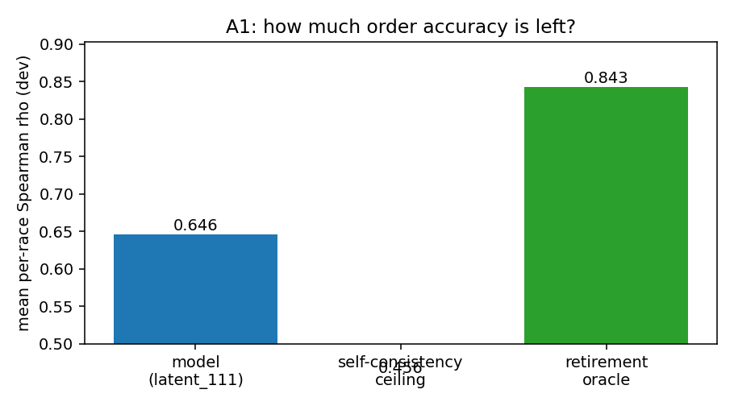
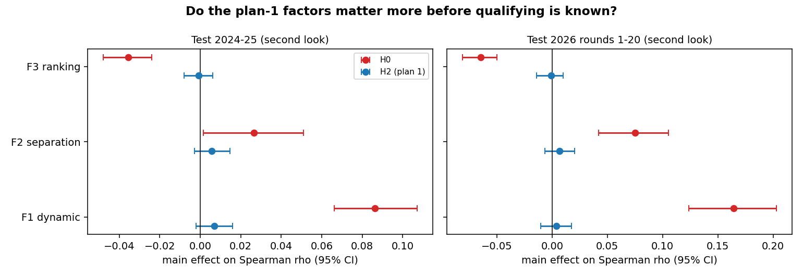
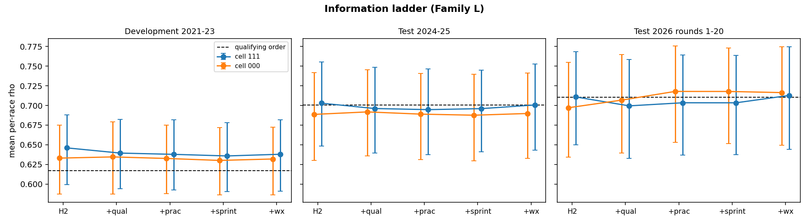
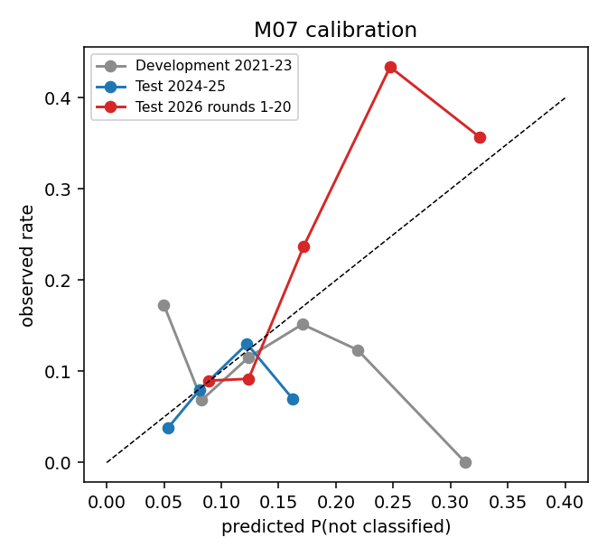
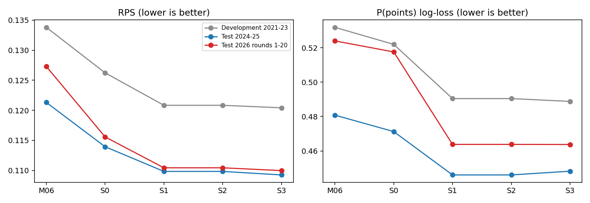
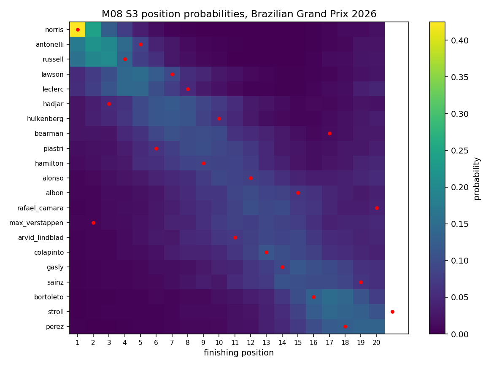

# PitLane plan 2 — results report

_Generated from `results/leaderboard.csv` (plan 1) and `results/plan2/leaderboard*.csv`. Plan-2 configs were
frozen on development data (hash `0d1b7c074d80`) before the test blocks were scored. **The 2024-2026 test
blocks had already been scored once in plan 1, so every test number here is a second look**; only the
"fresh holdout" (races after 2026 round 20) is untouched. Every number is a mean over races of per-race metrics;
intervals are 95% bootstrap CIs over races, comparisons are paired by race._

**Research question 2:** which pre-race information, and which race structure, add predictive value beyond qualifying order?

## 0. Data actually used (deviations from the plan)
| Planned | What happened |
|---|---|
| FastF1 practice laps and session weather, 2018+ | FastF1's timing API now answers 401 without an F1 account, so it could not be used. Practice laps and session weather come from **OpenF1** (no login), which only covers **2023 onward**. Practice features therefore exist for 2023-2026 only; earlier races carry a missing indicator. |
| Race-day forecast archive | Open-Meteo: ERA5 for the qualifying day (observed, all seasons) and its historical-forecast archive for the race window (used from 2020). |
| Sprint results | Jolpica sprint results, 2021+. |
| Race-pace oracle on all of dev | Jolpica allows ~500 requests/hour; race laps were fetched for the 2023 development season only. |
| Practice evaluated on dev 2021-23 | Practice data covers only 2023 in dev (22 races, with an early-2023 training set of 0-21 races). Practice groups are therefore judged on dev-2023 plus the test blocks, and the dev CI for them is wide by construction. |

## 1. A1 — Ceiling analysis (development block, oracles use race data and are not models)
| Quantity | Value |
|---|---|
| Model: `latent_111` (plan-1 proposed), 66 races | rho 0.646 |
| Self-consistency ceiling: model scored against orders sampled from its own calibrated distribution | rho 0.456 |
| Retirement oracle: retirees placed at their true positions | rho 0.843 (gain +0.197) |
| Race-pace oracle (finishers ranked by median clean race lap), 22 races of 2023 | model rho(finishers) 0.757 vs oracle 0.830 (gap +0.073) |

**Gate decision:** order accuracy is **not saturated** (gap >= 0.03): better race-pace information could still help order, so M06 used the full tuning round.

_Note: the self-consistency value is **below** the model's real rho, so it is not an upper bound. The Plackett-Luce temperature is fitted on whole orders, retirements included, and its sampled orders are noisier than real races are for a model of this sharpness; read it as the noise level the probability model assumes, not as a limit on accuracy._


## 2. Leaderboards (plan-1 reference models and plan-2 models)

`top-10 overlap` = how many of the predicted top 10 are in the real top 10; `exact` = share of drivers placed in their exact position; `RPS` = ranked probability score over the full position distribution (lower is better).

### Development 2021-23
| model | rho | MAE | top-10 overlap | top-5 overlap | exact | within 1 | within 2 | RPS | win logloss | points logloss | races |
|---|---|---|---|---|---|---|---|---|---|---|---|
| M02 gbm_001 | 0.661 | 3.29 | 0.785 |  |  |  |  |  | 0.1504 | 0.5215 | 66 |
| M01 rf_000 | 0.658 | 3.28 | 0.789 |  |  |  |  |  | 0.1578 | 0.5198 | 66 |
| M01 gbm_000 | 0.657 | 3.32 | 0.788 |  |  |  |  |  | 0.1581 | 0.5191 | 66 |
| M06 m06_G_h3_000 | 0.654 | 3.34 | 0.785 | 0.712 | 0.130 | 0.344 | 0.520 | 0.1313 | 0.1585 | 0.5193 | 66 |
| M03 latent_111 | 0.646 | 3.36 | 0.789 |  |  |  |  |  | 0.1581 | 0.5282 | 66 |
| M06 m06_L_r0_111 | 0.646 | 3.36 | 0.789 | 0.724 | 0.140 | 0.364 | 0.533 | 0.1336 | 0.1581 | 0.5282 | 66 |
| M04 gbm_111 | 0.644 | 3.38 | 0.783 |  |  |  |  |  | 0.1478 | 0.5346 | 66 |
| M06 m06_G_h3_111 | 0.641 | 3.38 | 0.780 | 0.697 | 0.139 | 0.359 | 0.516 | 0.1335 | 0.1480 | 0.5332 | 66 |
| M00 standings | 0.639 | 3.38 | 0.774 |  |  |  |  |  | 0.1700 | 0.5604 | 66 |
| M06 m06_L_r1_111 | 0.639 | 3.44 | 0.783 | 0.694 | 0.131 | 0.350 | 0.517 | 0.1342 | 0.1516 | 0.5347 | 66 |
| M08 m08_S3 | 0.638 | 3.42 | 0.777 | 0.724 | 0.136 | 0.351 | 0.526 | 0.1204 | 0.1154 | 0.4888 | 66 |
| M06 m06_L_r2_111 | 0.638 | 3.46 | 0.782 | 0.688 | 0.131 | 0.343 | 0.514 | 0.1341 | 0.1514 | 0.5341 | 66 |
| M06 m06_L_r4_111 | 0.638 | 3.40 | 0.777 | 0.727 | 0.143 | 0.361 | 0.520 | 0.1338 | 0.1546 | 0.5319 | 66 |
| M08 m08_S0 | 0.638 | 3.40 | 0.782 | 0.715 | 0.138 | 0.360 | 0.522 | 0.1262 | 0.1293 | 0.5220 | 66 |
| M08 m08_S1 | 0.637 | 3.40 | 0.776 | 0.724 | 0.143 | 0.361 | 0.523 | 0.1208 | 0.1181 | 0.4905 | 66 |
| M08 m08_S2 | 0.637 | 3.40 | 0.776 | 0.724 | 0.143 | 0.361 | 0.523 | 0.1208 | 0.1181 | 0.4905 | 66 |
| M06 m06_L_r3_111 | 0.636 | 3.47 | 0.779 | 0.676 | 0.132 | 0.342 | 0.516 | 0.1344 | 0.1514 | 0.5351 | 66 |
| M06 m06_L_r1_000 | 0.634 | 3.46 | 0.767 | 0.700 | 0.125 | 0.340 | 0.518 | 0.1336 | 0.1571 | 0.5304 | 66 |
| M06 m06_L_r0_000 | 0.633 | 3.48 | 0.773 | 0.691 | 0.123 | 0.340 | 0.510 | 0.1343 | 0.1589 | 0.5307 | 66 |
| M06 m06_L_r2_000 | 0.633 | 3.47 | 0.770 | 0.703 | 0.125 | 0.340 | 0.510 | 0.1333 | 0.1551 | 0.5277 | 66 |
| M03 latent_000 | 0.633 | 3.48 | 0.773 |  |  |  |  |  | 0.1589 | 0.5307 | 66 |
| M06 m06_L_r4_000 | 0.632 | 3.46 | 0.768 | 0.691 | 0.126 | 0.337 | 0.513 | 0.1337 | 0.1549 | 0.5312 | 66 |
| M06 m06_L_r3_000 | 0.630 | 3.48 | 0.768 | 0.691 | 0.126 | 0.336 | 0.510 | 0.1336 | 0.1545 | 0.5301 | 66 |
| M00 quali | 0.617 | 3.51 | 0.756 |  |  |  |  |  | 0.1622 | 0.5373 | 66 |
| A2 h1_latent_111 | 0.611 | 3.71 | 0.765 | 0.652 | 0.095 | 0.295 | 0.464 | 0.1408 | 0.1631 | 0.5573 | 66 |
| A2 h0_latent_111 | 0.607 | 3.72 | 0.761 | 0.652 | 0.102 | 0.300 | 0.463 | 0.1416 | 0.1653 | 0.5621 | 66 |
| A2 h0_latent_110 | 0.605 | 3.69 | 0.750 | 0.645 | 0.111 | 0.314 | 0.471 | 0.1388 | 0.1598 | 0.5478 | 66 |
| A2 h0_latent_100 | 0.599 | 3.70 | 0.750 | 0.615 | 0.135 | 0.311 | 0.460 | 0.1398 | 0.1586 | 0.5511 | 66 |
| A2 h0_latent_010 | 0.594 | 3.81 | 0.742 | 0.661 | 0.087 | 0.301 | 0.459 | 0.1426 | 0.1716 | 0.5652 | 66 |
| M00 grid | 0.592 | 3.60 | 0.750 |  |  |  |  |  | 0.1644 | 0.5479 | 66 |
| A2 h0_latent_011 | 0.580 | 3.87 | 0.726 | 0.664 | 0.103 | 0.281 | 0.450 | 0.1472 | 0.1777 | 0.5882 | 66 |
| A2 h0_latent_101 | 0.550 | 4.03 | 0.717 | 0.576 | 0.101 | 0.278 | 0.423 | 0.1460 | 0.1606 | 0.5844 | 66 |
| A2 h1_latent_000 | 0.466 | 4.54 | 0.680 | 0.500 | 0.085 | 0.232 | 0.370 | 0.1527 | 0.1743 | 0.6055 | 66 |
| A2 h0_latent_000 | 0.451 | 4.61 | 0.673 | 0.491 | 0.075 | 0.229 | 0.365 | 0.1547 | 0.1789 | 0.6166 | 66 |
| A2 h0_latent_001 | 0.431 | 4.74 | 0.662 | 0.479 | 0.064 | 0.204 | 0.344 | 0.1577 | 0.1825 | 0.6329 | 66 |

### Test 2024-25 (second look)
| model | rho | MAE | top-10 overlap | top-5 overlap | exact | within 1 | within 2 | RPS | win logloss | points logloss | races |
|---|---|---|---|---|---|---|---|---|---|---|---|
| M01 rf_000 | 0.712 | 3.02 | 0.810 |  |  |  |  |  | 0.1489 | 0.4728 | 48 |
| M03 latent_111 | 0.703 | 3.06 | 0.810 |  |  |  |  |  | 0.1485 | 0.4776 | 48 |
| M06 m06_L_r0_111 | 0.703 | 3.06 | 0.810 | 0.787 | 0.165 | 0.390 | 0.551 | 0.1218 | 0.1485 | 0.4776 | 48 |
| M06 m06_G_h3_000 | 0.703 | 3.09 | 0.798 | 0.787 | 0.159 | 0.382 | 0.543 | 0.1211 | 0.1486 | 0.4771 | 48 |
| M08 m08_S3 | 0.702 | 3.05 | 0.794 | 0.800 | 0.177 | 0.380 | 0.569 | 0.1093 | 0.1087 | 0.4482 | 48 |
| M00 quali | 0.701 | 3.06 | 0.817 |  |  |  |  |  | 0.1574 | 0.4899 | 48 |
| M06 m06_L_r4_111 | 0.701 | 3.06 | 0.796 | 0.800 | 0.170 | 0.387 | 0.563 | 0.1213 | 0.1456 | 0.4808 | 48 |
| M06 m06_G_h3_111 | 0.701 | 3.09 | 0.794 | 0.783 | 0.157 | 0.376 | 0.551 | 0.1219 | 0.1437 | 0.4900 | 48 |
| M08 m08_S1 | 0.700 | 3.07 | 0.794 | 0.800 | 0.170 | 0.381 | 0.569 | 0.1098 | 0.1129 | 0.4460 | 48 |
| M02 gbm_001 | 0.700 | 3.14 | 0.800 |  |  |  |  |  | 0.1440 | 0.4851 | 48 |
| M08 m08_S2 | 0.700 | 3.07 | 0.794 | 0.800 | 0.170 | 0.381 | 0.569 | 0.1098 | 0.1129 | 0.4460 | 48 |
| M08 m08_S0 | 0.700 | 3.08 | 0.794 | 0.804 | 0.165 | 0.381 | 0.563 | 0.1139 | 0.1242 | 0.4713 | 48 |
| M01 gbm_000 | 0.699 | 3.11 | 0.802 |  |  |  |  |  | 0.1493 | 0.4816 | 48 |
| M04 gbm_111 | 0.696 | 3.18 | 0.794 |  |  |  |  |  | 0.1446 | 0.4973 | 48 |
| M06 m06_L_r3_111 | 0.696 | 3.13 | 0.798 | 0.771 | 0.147 | 0.374 | 0.552 | 0.1227 | 0.1451 | 0.4889 | 48 |
| M06 m06_L_r1_111 | 0.696 | 3.14 | 0.790 | 0.771 | 0.130 | 0.364 | 0.542 | 0.1231 | 0.1455 | 0.4919 | 48 |
| M06 m06_L_r2_111 | 0.695 | 3.14 | 0.792 | 0.771 | 0.136 | 0.367 | 0.546 | 0.1227 | 0.1454 | 0.4901 | 48 |
| M06 m06_L_r1_000 | 0.692 | 3.16 | 0.800 | 0.771 | 0.140 | 0.369 | 0.545 | 0.1229 | 0.1504 | 0.4823 | 48 |
| M06 m06_L_r4_000 | 0.690 | 3.17 | 0.802 | 0.767 | 0.135 | 0.376 | 0.540 | 0.1235 | 0.1520 | 0.4840 | 48 |
| M00 grid | 0.690 | 3.10 | 0.808 |  |  |  |  |  | 0.1594 | 0.4948 | 48 |
| M06 m06_L_r0_000 | 0.689 | 3.19 | 0.808 | 0.758 | 0.145 | 0.346 | 0.540 | 0.1242 | 0.1546 | 0.4831 | 48 |
| M06 m06_L_r2_000 | 0.689 | 3.18 | 0.804 | 0.763 | 0.133 | 0.372 | 0.537 | 0.1232 | 0.1513 | 0.4823 | 48 |
| M03 latent_000 | 0.689 | 3.19 | 0.808 |  |  |  |  |  | 0.1546 | 0.4831 | 48 |
| M06 m06_L_r3_000 | 0.688 | 3.18 | 0.802 | 0.762 | 0.133 | 0.370 | 0.537 | 0.1237 | 0.1520 | 0.4847 | 48 |
| M00 standings | 0.638 | 3.50 | 0.754 |  |  |  |  |  | 0.1692 | 0.5532 | 48 |
| A2 h0_latent_110 | 0.609 | 3.72 | 0.746 | 0.725 | 0.113 | 0.302 | 0.452 | 0.1352 | 0.1614 | 0.5348 | 48 |
| A2 h1_latent_111 | 0.605 | 3.77 | 0.754 | 0.667 | 0.104 | 0.296 | 0.446 | 0.1380 | 0.1637 | 0.5423 | 48 |
| A2 h0_latent_100 | 0.603 | 3.77 | 0.750 | 0.733 | 0.112 | 0.297 | 0.441 | 0.1356 | 0.1604 | 0.5305 | 48 |
| A2 h0_latent_101 | 0.573 | 3.91 | 0.742 | 0.688 | 0.111 | 0.292 | 0.446 | 0.1394 | 0.1593 | 0.5506 | 48 |
| A2 h0_latent_111 | 0.565 | 3.97 | 0.748 | 0.633 | 0.099 | 0.273 | 0.430 | 0.1409 | 0.1674 | 0.5556 | 48 |
| A2 h0_latent_010 | 0.551 | 4.10 | 0.744 | 0.600 | 0.104 | 0.262 | 0.410 | 0.1445 | 0.1755 | 0.5640 | 48 |
| A2 h1_latent_000 | 0.534 | 4.26 | 0.713 | 0.646 | 0.095 | 0.250 | 0.373 | 0.1498 | 0.1775 | 0.5872 | 48 |
| A2 h0_latent_011 | 0.505 | 4.42 | 0.733 | 0.542 | 0.066 | 0.221 | 0.364 | 0.1516 | 0.1841 | 0.5931 | 48 |
| A2 h0_latent_000 | 0.486 | 4.52 | 0.694 | 0.596 | 0.073 | 0.227 | 0.351 | 0.1547 | 0.1830 | 0.6091 | 48 |
| A2 h0_latent_001 | 0.463 | 4.64 | 0.667 | 0.604 | 0.072 | 0.226 | 0.358 | 0.1595 | 0.1869 | 0.6280 | 48 |

### Test 2026 rounds 1-20 (second look)
| model | rho | MAE | top-10 overlap | top-5 overlap | exact | within 1 | within 2 | RPS | win logloss | points logloss | races |
|---|---|---|---|---|---|---|---|---|---|---|---|
| M06 m06_G_h3_111 | 0.725 | 3.19 | 0.780 | 0.740 | 0.131 | 0.344 | 0.552 | 0.1245 | 0.1380 | 0.5098 | 20 |
| M06 m06_L_r2_000 | 0.718 | 3.26 | 0.790 | 0.700 | 0.112 | 0.326 | 0.552 | 0.1239 | 0.1462 | 0.5073 | 20 |
| M06 m06_L_r3_000 | 0.718 | 3.25 | 0.790 | 0.700 | 0.121 | 0.328 | 0.554 | 0.1240 | 0.1462 | 0.5079 | 20 |
| M06 m06_L_r4_000 | 0.716 | 3.26 | 0.790 | 0.690 | 0.121 | 0.326 | 0.550 | 0.1241 | 0.1463 | 0.5083 | 20 |
| M06 m06_G_h3_000 | 0.715 | 3.20 | 0.780 | 0.740 | 0.144 | 0.372 | 0.552 | 0.1233 | 0.1419 | 0.4984 | 20 |
| M06 m06_L_r4_111 | 0.713 | 3.26 | 0.770 | 0.720 | 0.133 | 0.376 | 0.530 | 0.1273 | 0.1449 | 0.5240 | 20 |
| M08 m08_S2 | 0.713 | 3.29 | 0.780 | 0.710 | 0.116 | 0.357 | 0.513 | 0.1104 | 0.1084 | 0.4638 | 20 |
| M08 m08_S0 | 0.713 | 3.28 | 0.770 | 0.720 | 0.117 | 0.361 | 0.520 | 0.1156 | 0.1202 | 0.5176 | 20 |
| M08 m08_S1 | 0.713 | 3.29 | 0.780 | 0.710 | 0.116 | 0.357 | 0.513 | 0.1104 | 0.1084 | 0.4638 | 20 |
| M08 m08_S3 | 0.712 | 3.26 | 0.780 | 0.720 | 0.138 | 0.368 | 0.523 | 0.1100 | 0.1035 | 0.4637 | 20 |
| M03 latent_111 | 0.711 | 3.25 | 0.775 |  |  |  |  |  | 0.1511 | 0.5200 | 20 |
| M06 m06_L_r0_111 | 0.711 | 3.25 | 0.775 | 0.710 | 0.101 | 0.365 | 0.546 | 0.1284 | 0.1511 | 0.5200 | 20 |
| M00 quali | 0.710 | 3.18 | 0.770 |  |  |  |  |  | 0.1475 | 0.5053 | 20 |
| M06 m06_L_r1_000 | 0.707 | 3.35 | 0.785 | 0.710 | 0.111 | 0.312 | 0.519 | 0.1265 | 0.1476 | 0.5129 | 20 |
| M04 gbm_111 | 0.706 | 3.22 | 0.775 |  |  |  |  |  | 0.1399 | 0.5300 | 20 |
| M01 gbm_000 | 0.706 | 3.26 | 0.790 |  |  |  |  |  | 0.1448 | 0.5116 | 20 |
| M01 rf_000 | 0.706 | 3.24 | 0.795 |  |  |  |  |  | 0.1438 | 0.5118 | 20 |
| M02 gbm_001 | 0.704 | 3.26 | 0.785 |  |  |  |  |  | 0.1408 | 0.5179 | 20 |
| M00 standings | 0.704 | 3.29 | 0.785 |  |  |  |  |  | 0.1632 | 0.5582 | 20 |
| M06 m06_L_r3_111 | 0.703 | 3.34 | 0.780 | 0.710 | 0.128 | 0.369 | 0.540 | 0.1312 | 0.1498 | 0.5387 | 20 |
| M06 m06_L_r2_111 | 0.703 | 3.34 | 0.780 | 0.710 | 0.121 | 0.375 | 0.546 | 0.1311 | 0.1500 | 0.5396 | 20 |
| M06 m06_L_r1_111 | 0.699 | 3.38 | 0.775 | 0.700 | 0.107 | 0.361 | 0.535 | 0.1316 | 0.1507 | 0.5370 | 20 |
| M03 latent_000 | 0.697 | 3.39 | 0.780 |  |  |  |  |  | 0.1498 | 0.5135 | 20 |
| M06 m06_L_r0_000 | 0.697 | 3.39 | 0.780 | 0.720 | 0.099 | 0.332 | 0.517 | 0.1276 | 0.1498 | 0.5135 | 20 |
| M00 grid | 0.666 | 3.36 | 0.760 |  |  |  |  |  | 0.1506 | 0.5281 | 20 |
| A2 h1_latent_111 | 0.655 | 3.80 | 0.750 | 0.740 | 0.090 | 0.270 | 0.470 | 0.1353 | 0.1598 | 0.5493 | 20 |
| A2 h0_latent_110 | 0.650 | 3.71 | 0.755 | 0.680 | 0.113 | 0.305 | 0.464 | 0.1353 | 0.1629 | 0.5450 | 20 |
| A2 h0_latent_100 | 0.623 | 3.88 | 0.760 | 0.650 | 0.088 | 0.296 | 0.460 | 0.1389 | 0.1654 | 0.5571 | 20 |
| A2 h0_latent_111 | 0.567 | 4.33 | 0.760 | 0.610 | 0.089 | 0.224 | 0.383 | 0.1440 | 0.1679 | 0.5687 | 20 |
| A2 h1_latent_000 | 0.549 | 4.56 | 0.700 | 0.710 | 0.095 | 0.214 | 0.362 | 0.1452 | 0.1671 | 0.5728 | 20 |
| A2 h0_latent_101 | 0.535 | 4.47 | 0.725 | 0.660 | 0.080 | 0.233 | 0.387 | 0.1488 | 0.1726 | 0.5935 | 20 |
| A2 h0_latent_010 | 0.528 | 4.61 | 0.720 | 0.610 | 0.074 | 0.227 | 0.376 | 0.1448 | 0.1683 | 0.5652 | 20 |
| A2 h0_latent_011 | 0.451 | 5.06 | 0.685 | 0.710 | 0.064 | 0.216 | 0.349 | 0.1484 | 0.1640 | 0.5774 | 20 |
| A2 h0_latent_000 | 0.374 | 5.53 | 0.620 | 0.630 | 0.062 | 0.191 | 0.298 | 0.1622 | 0.1770 | 0.6324 | 20 |
| A2 h0_latent_001 | 0.364 | 5.58 | 0.595 | 0.630 | 0.081 | 0.208 | 0.297 | 0.1615 | 0.1801 | 0.6315 | 20 |

### Fresh holdout (2026 after round 20)
_No races yet (the 2026 season data ends at round 20); the pipeline scores them automatically when `scripts/run_plan2.py` is re-run after re-ingesting._

## 3. A2 — The three plan-1 factors at different forecast horizons (Family L)

H0 = history only (no qualifying, no practice); H2 = plan 1 (history + qualifying position/grid/Q1 gap) from the plan-1 runs; H1 = history + practice only (practice exists from 2023, so on 2021-22 it equals H0). Effect = average gain from switching a factor ON over the other two.

### Development 2021-23
**H0 (history only)**

| effect | d rho [95% CI] | p (Wilcoxon) |
|---|---|---|
| F1 dynamic | +0.076 [+0.059, +0.093] | 0.000 |
| F2 driver-car separation | +0.089 [+0.071, +0.108] | 0.000 |
| F3 structured ranking | -0.020 [-0.028, -0.013] | 0.000 |
| F1 x F2 | -0.029 [-0.034, -0.023] | 0.000 |
| F1 x F3 | -0.002 [-0.005, +0.001] | 0.346 |
| F2 x F3 | +0.007 [+0.003, +0.011] | 0.005 |

**H2 (plan 1: history + qualifying)**

| effect | d rho [95% CI] | p (Wilcoxon) |
|---|---|---|
| F1 dynamic | +0.007 [-0.002, +0.016] | 0.058 |
| F2 driver-car separation | +0.012 [+0.004, +0.020] | 0.012 |
| F3 structured ranking | -0.010 [-0.019, -0.000] | 0.014 |
| F1 x F2 | -0.002 [-0.004, +0.001] | 0.116 |
| F1 x F3 | -0.000 [-0.002, +0.002] | 0.791 |
| F2 x F3 | +0.001 [-0.002, +0.003] | 0.415 |

### Test 2024-25 (second look)
**H0 (history only)**

| effect | d rho [95% CI] | p (Wilcoxon) |
|---|---|---|
| F1 dynamic | +0.086 [+0.066, +0.107] | 0.000 |
| F2 driver-car separation | +0.026 [+0.002, +0.050] | 0.019 |
| F3 structured ranking | -0.036 [-0.047, -0.024] | 0.000 |
| F1 x F2 | -0.014 [-0.022, -0.005] | 0.004 |
| F1 x F3 | -0.000 [-0.006, +0.005] | 0.996 |
| F2 x F3 | -0.005 [-0.009, -0.000] | 0.088 |

**H2 (plan 1: history + qualifying)**

| effect | d rho [95% CI] | p (Wilcoxon) |
|---|---|---|
| F1 dynamic | +0.007 [-0.002, +0.016] | 0.165 |
| F2 driver-car separation | +0.006 [-0.003, +0.014] | 0.532 |
| F3 structured ranking | -0.001 [-0.008, +0.006] | 0.678 |
| F1 x F2 | +0.001 [-0.001, +0.003] | 0.580 |
| F1 x F3 | -0.001 [-0.004, +0.001] | 0.754 |
| F2 x F3 | +0.001 [-0.002, +0.003] | 0.825 |

### Test 2026 rounds 1-20 (second look)
**H0 (history only)**

| effect | d rho [95% CI] | p (Wilcoxon) |
|---|---|---|
| F1 dynamic | +0.164 [+0.125, +0.203] | 0.000 |
| F2 driver-car separation | +0.075 [+0.041, +0.105] | 0.001 |
| F3 structured ranking | -0.065 [-0.080, -0.050] | 0.000 |
| F1 x F2 | -0.023 [-0.031, -0.014] | 0.000 |
| F1 x F3 | -0.010 [-0.015, -0.006] | 0.000 |
| F2 x F3 | -0.008 [-0.014, -0.002] | 0.036 |

**H2 (plan 1: history + qualifying)**

| effect | d rho [95% CI] | p (Wilcoxon) |
|---|---|---|
| F1 dynamic | +0.004 [-0.011, +0.018] | 0.478 |
| F2 driver-car separation | +0.007 [-0.007, +0.021] | 0.245 |
| F3 structured ranking | -0.001 [-0.014, +0.010] | 0.388 |
| F1 x F2 | +0.001 [-0.003, +0.005] | 0.911 |
| F1 x F3 | -0.004 [-0.006, -0.002] | 0.004 |
| F2 x F3 | +0.002 [-0.001, +0.006] | 0.409 |

### Mean rho by horizon (A = all factors off, D = all on)
| split | H0 A | H0 D | H1 A | H1 D | H2 A | H2 D | grid | quali | standings |
|---|---|---|---|---|---|---|---|---|---|
| Development 2021-23 | 0.451 | 0.607 | 0.466 | 0.611 | 0.633 | 0.646 | 0.592 | 0.617 | 0.639 |
| Test 2024-25 (second look) | 0.486 | 0.565 | 0.534 | 0.605 | 0.689 | 0.703 | 0.690 | 0.701 | 0.638 |
| Test 2026 rounds 1-20 (second look) | 0.374 | 0.567 | 0.549 | 0.655 | 0.697 | 0.711 | 0.666 | 0.710 | 0.704 |



## 4. M06 — Does weekend information beyond qualifying position add anything? (Family L)

Every rung and leave-one-out variant is tuned separately on dev with the same grid (`r0` is the plan-1 frozen model, reproduced below). Rule (fixed in `PLAN2.md` §5): a group adds value if its paired dev gain has a 95% CI above 0 **and** the gain has the same sign on test 2024-25. Practice is judged on dev-2023 only (the only dev season with practice data).

**Reproduction check (P0):** the plan-1 latent models re-run under the plan-2 code differ from the stored plan-1 runs by at most 0.00e+00 in per-race rho.

### Information ladder, cell 111 (proposed, all three factors on)
| split | rung | rho | MAE | d rho vs previous rung | d rho vs H2 |
|---|---|---|---|---|---|
| Development 2021-23 | H2 = plan 1 | 0.646 | 3.36 | n/a | n/a |
| Development 2021-23 | + richer qualifying | 0.639 | 3.44 | -0.007 [-0.016, +0.003] | -0.007 [-0.016, +0.003] |
| Development 2021-23 | + practice | 0.638 | 3.46 | -0.002 [-0.006, +0.002] | -0.008 [-0.019, +0.003] |
| Development 2021-23 | + sprint | 0.636 | 3.47 | -0.002 [-0.006, +0.001] | -0.010 [-0.023, +0.002] |
| Development 2021-23 | + weather = H3 | 0.638 | 3.40 | +0.002 [-0.007, +0.011] | -0.008 [-0.018, +0.001] |
| Test 2024-25 | H2 = plan 1 | 0.703 | 3.06 | n/a | n/a |
| Test 2024-25 | + richer qualifying | 0.696 | 3.14 | -0.007 [-0.019, +0.005] | -0.007 [-0.018, +0.004] |
| Test 2024-25 | + practice | 0.695 | 3.14 | -0.001 [-0.007, +0.003] | -0.008 [-0.019, +0.003] |
| Test 2024-25 | + sprint | 0.696 | 3.13 | +0.001 [-0.004, +0.006] | -0.007 [-0.019, +0.006] |
| Test 2024-25 | + weather = H3 | 0.701 | 3.06 | +0.005 [-0.005, +0.014] | -0.002 [-0.013, +0.008] |
| Test 2026 rounds 1-20 | H2 = plan 1 | 0.711 | 3.25 | n/a | n/a |
| Test 2026 rounds 1-20 | + richer qualifying | 0.699 | 3.38 | -0.011 [-0.030, +0.009] | -0.011 [-0.030, +0.009] |
| Test 2026 rounds 1-20 | + practice | 0.703 | 3.34 | +0.004 [-0.006, +0.015] | -0.007 [-0.026, +0.014] |
| Test 2026 rounds 1-20 | + sprint | 0.703 | 3.34 | -0.000 [-0.005, +0.005] | -0.007 [-0.027, +0.013] |
| Test 2026 rounds 1-20 | + weather = H3 | 0.713 | 3.26 | +0.009 [-0.005, +0.024] | +0.002 [-0.011, +0.015] |

### Information ladder, cell 000 (all factors off)
| split | rung | rho | MAE | d rho vs previous rung | d rho vs H2 |
|---|---|---|---|---|---|
| Development 2021-23 | H2 = plan 1 | 0.633 | 3.48 | n/a | n/a |
| Development 2021-23 | + richer qualifying | 0.634 | 3.46 | +0.002 [-0.004, +0.007] | +0.002 [-0.004, +0.007] |
| Development 2021-23 | + practice | 0.633 | 3.47 | -0.002 [-0.015, +0.008] | -0.000 [-0.015, +0.012] |
| Development 2021-23 | + sprint | 0.630 | 3.48 | -0.002 [-0.007, +0.002] | -0.003 [-0.019, +0.011] |
| Development 2021-23 | + weather = H3 | 0.632 | 3.46 | +0.002 [-0.000, +0.004] | -0.001 [-0.017, +0.013] |
| Test 2024-25 | H2 = plan 1 | 0.689 | 3.19 | n/a | n/a |
| Test 2024-25 | + richer qualifying | 0.692 | 3.16 | +0.003 [-0.003, +0.009] | +0.003 [-0.003, +0.009] |
| Test 2024-25 | + practice | 0.689 | 3.18 | -0.003 [-0.011, +0.004] | +0.000 [-0.007, +0.008] |
| Test 2024-25 | + sprint | 0.688 | 3.18 | -0.001 [-0.003, +0.000] | -0.001 [-0.009, +0.007] |
| Test 2024-25 | + weather = H3 | 0.690 | 3.17 | +0.002 [+0.000, +0.004] | +0.001 [-0.007, +0.009] |
| Test 2026 rounds 1-20 | H2 = plan 1 | 0.697 | 3.39 | n/a | n/a |
| Test 2026 rounds 1-20 | + richer qualifying | 0.707 | 3.35 | +0.010 [-0.002, +0.023] | +0.010 [-0.003, +0.022] |
| Test 2026 rounds 1-20 | + practice | 0.718 | 3.26 | +0.011 [+0.002, +0.020] | +0.021 [+0.005, +0.038] |
| Test 2026 rounds 1-20 | + sprint | 0.718 | 3.25 | -0.000 [-0.001, +0.001] | +0.021 [+0.004, +0.039] |
| Test 2026 rounds 1-20 | + weather = H3 | 0.716 | 3.26 | -0.001 [-0.004, +0.001] | +0.019 [+0.003, +0.037] |

### Leave-one-group-out from H3 (cell 111)
| group removed from H3 | d rho (H3 - without) dev | d rho (H3 - without) test_stable | d rho (H3 - without) test_shift |
|---|---|---|---|
| richer qualifying (Q1-Q3 gaps, session reached, teammate gap) | -0.005 [-0.013, +0.002] | -0.004 [-0.013, +0.005] | +0.000 [-0.011, +0.012] |
| practice pace (best lap, long run, laps) | -0.004 [-0.016, +0.006] | +0.003 [-0.002, +0.008] | +0.005 [-0.004, +0.014] |
| sprint result | +0.001 [-0.008, +0.011] | +0.005 [-0.005, +0.014] | +0.011 [-0.003, +0.024] |
| weather (wet qualifying, race forecast, mismatch x qualifying) | +0.002 [-0.008, +0.012] | +0.005 [-0.005, +0.014] | +0.009 [-0.005, +0.024] |

### Verdict per information group (decision rule)
| group | dev gain (rung) | test 2024-25 gain (rung) | verdict | dev races |
|---|---|---|---|---|
| richer qualifying (Q1-Q3 gaps, session reached, teammate gap) | -0.007 [-0.016, +0.003] | -0.007 [-0.019, +0.005] | no gain | 66 |
| practice pace (best lap, long run, laps) | -0.005 [-0.020, +0.007] | -0.001 [-0.007, +0.003] | no gain | 21 |
| sprint result | -0.002 [-0.005, +0.001] | +0.001 [-0.004, +0.006] | positive on test only | 66 |
| weather (wet qualifying, race forecast, mismatch x qualifying) | +0.002 [-0.007, +0.012] | +0.005 [-0.005, +0.014] | positive on both blocks, rule not met (dev CI includes 0) | 66 |

### Family G (LightGBM): H3 against the plan-1 features
| cell | split | H2 (plan 1) rho | H3 rho | d rho [CI] |
|---|---|---|---|---|
| 000 | Development 2021-23 | 0.657 | 0.654 | -0.003 [-0.010, +0.004] |
| 000 | Test 2024-25 | 0.699 | 0.703 | +0.004 [-0.006, +0.014] |
| 000 | Test 2026 rounds 1-20 | 0.706 | 0.715 | +0.009 [+0.000, +0.018] |
| 111 | Development 2021-23 | 0.644 | 0.641 | -0.003 [-0.013, +0.006] |
| 111 | Test 2024-25 | 0.696 | 0.701 | +0.005 [-0.008, +0.017] |
| 111 | Test 2026 rounds 1-20 | 0.706 | 0.725 | +0.020 [+0.008, +0.033] |



## 5. M07 — DNF hazard model (logistic, walk-forward)

`d logloss` is baseline minus hazard model: positive = the hazard model is better. Target = not classified.

| split | logloss hazard | logloss constant | logloss decayed-rate | Brier hazard | Brier constant | AUC hazard | d logloss vs constant [CI] | d logloss vs decayed-rate [CI] | races |
|---|---|---|---|---|---|---|---|---|---|
| Development 2021-23 | 0.3698 | 0.3745 | 0.3755 | 0.1063 | 0.1075 | 0.550 | +0.0047 [-0.0066, +0.0140] | +0.0057 [-0.0027, +0.0138] | 66 |
| Test 2024-25 (second look) | 0.3253 | 0.3380 | 0.3342 | 0.0907 | 0.0933 | 0.607 | +0.0128 [+0.0029, +0.0219] | +0.0090 [+0.0015, +0.0171] | 48 |
| Test 2026 rounds 1-20 (second look) | 0.4241 | 0.4563 | 0.4366 | 0.1314 | 0.1410 | 0.726 | +0.0322 [+0.0188, +0.0470] | +0.0126 [+0.0024, +0.0229] | 20 |

Coefficients of the last refit (standardised features; positive = more retirements):

| feature | coef |
|---|---|
| drv_inc_ew16 | -0.0231 |
| drv_dnf_ew16 | 0.0104 |
| con_mech_ew16 | 0.1281 |
| con_dnf_ew16 | 0.0411 |
| circ_dnf | 0.0393 |
| grid_norm | 0.2263 |
| pit_start | -0.0093 |
| wet_q | -0.041 |
| rain_fc | -0.021 |
| newregs | 0.0649 |
| rookie | 0.0142 |
| new_team | -0.0 |
| fp_laps | -0.0853 |
| fp_missing | 0.0778 |
| intercept | -1.823863411049519 |



## 6. M08 — Race-level Monte Carlo simulator

S0 = Plackett-Luce sampling of the M06 scores (tau fitted on dev by RPS); S1 = + retirements from M07; S2 = + circuit grid stickiness; S3 = + race-regime mixture. `M06 harness` is M06's own probabilities (online-calibrated tau, no retirement model).

### Development 2021-23
| model | RPS | points logloss | win logloss | podium Brier | rho | MAE | d RPS vs previous (positive = better) [CI] | d points logloss vs previous [CI] |
|---|---|---|---|---|---|---|---|---|
| M06 harness | 0.1338 | 0.5319 | 0.1546 | 0.0944 | 0.638 | 3.40 |  |  |
| S0 PL only | 0.1262 | 0.5220 | 0.1293 | 0.0784 | 0.638 | 3.40 | +0.0076 [+0.0047, +0.0103] | +0.0099 [-0.0130, +0.0318] |
| S1 + retirements | 0.1208 | 0.4905 | 0.1181 | 0.0737 | 0.637 | 3.40 | +0.0054 [+0.0041, +0.0067] | +0.0316 [+0.0159, +0.0485] |
| S2 + stickiness | 0.1208 | 0.4905 | 0.1181 | 0.0737 | 0.637 | 3.40 | +0.0000 [+0.0000, +0.0000] | +0.0000 [+0.0000, +0.0000] |
| S3 + regime | 0.1204 | 0.4888 | 0.1154 | 0.0735 | 0.638 | 3.42 | +0.0004 [-0.0002, +0.0011] | +0.0016 [-0.0037, +0.0073] |

### Test 2024-25 (second look)
| model | RPS | points logloss | win logloss | podium Brier | rho | MAE | d RPS vs previous (positive = better) [CI] | d points logloss vs previous [CI] |
|---|---|---|---|---|---|---|---|---|
| M06 harness | 0.1213 | 0.4808 | 0.1456 | 0.0862 | 0.701 | 3.06 |  |  |
| S0 PL only | 0.1139 | 0.4713 | 0.1242 | 0.0727 | 0.700 | 3.08 | +0.0074 [+0.0045, +0.0104] | +0.0096 [-0.0264, +0.0401] |
| S1 + retirements | 0.1098 | 0.4460 | 0.1129 | 0.0676 | 0.700 | 3.07 | +0.0041 [+0.0029, +0.0053] | +0.0252 [+0.0021, +0.0519] |
| S2 + stickiness | 0.1098 | 0.4460 | 0.1129 | 0.0676 | 0.700 | 3.07 | +0.0000 [+0.0000, +0.0000] | +0.0000 [+0.0000, +0.0000] |
| S3 + regime | 0.1093 | 0.4482 | 0.1087 | 0.0662 | 0.702 | 3.05 | +0.0006 [+0.0001, +0.0011] | -0.0022 [-0.0075, +0.0030] |

### Test 2026 rounds 1-20 (second look)
| model | RPS | points logloss | win logloss | podium Brier | rho | MAE | d RPS vs previous (positive = better) [CI] | d points logloss vs previous [CI] |
|---|---|---|---|---|---|---|---|---|
| M06 harness | 0.1273 | 0.5240 | 0.1449 | 0.0902 | 0.713 | 3.26 |  |  |
| S0 PL only | 0.1156 | 0.5176 | 0.1202 | 0.0753 | 0.713 | 3.28 | +0.0117 [+0.0061, +0.0168] | +0.0064 [-0.0612, +0.0637] |
| S1 + retirements | 0.1104 | 0.4638 | 0.1084 | 0.0723 | 0.713 | 3.29 | +0.0051 [+0.0034, +0.0070] | +0.0538 [+0.0196, +0.1055] |
| S2 + stickiness | 0.1104 | 0.4638 | 0.1084 | 0.0723 | 0.713 | 3.29 | +0.0000 [+0.0000, +0.0000] | +0.0000 [+0.0000, +0.0000] |
| S3 + regime | 0.1100 | 0.4637 | 0.1035 | 0.0729 | 0.712 | 3.26 | +0.0005 [-0.0002, +0.0012] | +0.0001 [-0.0089, +0.0095] |

### Parameters fitted on the development block
| variant | tau | dnf_scale | kappa | p0 | s_dis | a_vol | a_rain | dev RPS (fit) |
|---|---|---|---|---|---|---|---|---|
| S0 | 1.7 | 1.0 | 0.0 | 0.1 | 2.0 | 0.0 | 0.0 | 0.1266 |
| S1 | 2.5 | 1.0 | 0.0 | 0.1 | 2.0 | 0.0 | 0.0 | 0.1209 |
| S2 | 2.5 | 1.0 | 0.0 | 0.1 | 2.0 | 0.0 | 0.0 | 0.1209 |
| S3 | 3.5 | 1.25 | 0.0 | 0.2 | 2.0 | 0.5 | 2.0 | 0.1204 |



## 7. Where does it help? Subsets (mean per-race rho; counts are races)

| split | subset | qualifying order | plan-1 latent_111 | M06 H3 (latent) | M08 S3 | races |
|---|---|---|---|---|---|---|
| Development 2021-23 | first five rounds of a season | 0.631 | 0.638 | 0.633 | 0.633 | 15 |
| Development 2021-23 | wet-affected weekend | 0.592 | 0.646 | 0.634 | 0.636 | 19 |
| Development 2021-23 | sprint weekend | 0.539 | 0.581 | 0.537 | 0.547 | 12 |
| Development 2021-23 | practice data available | 0.606 | 0.660 | 0.650 | 0.649 | 21 |
| Test 2024-25 | first five rounds of a season | 0.712 | 0.711 | 0.718 | 0.720 | 10 |
| Test 2024-25 | wet-affected weekend | 0.762 | 0.777 | 0.773 | 0.771 | 11 |
| Test 2024-25 | sprint weekend | 0.713 | 0.702 | 0.700 | 0.699 | 12 |
| Test 2024-25 | practice data available | 0.701 | 0.703 | 0.701 | 0.702 | 48 |
| Test 2026 rounds 1-20 | first five rounds of a season | 0.700 | 0.708 | 0.688 | 0.696 | 5 |
| Test 2026 rounds 1-20 | wet-affected weekend | 0.695 | 0.726 | 0.783 | 0.758 | 2 |
| Test 2026 rounds 1-20 | sprint weekend | 0.693 | 0.684 | 0.683 | 0.684 | 6 |
| Test 2026 rounds 1-20 | practice data available | 0.710 | 0.711 | 0.713 | 0.712 | 20 |

_Subsets under 10 races are not interpreted (PLAN2.md §7)._

Mean absolute position error for flagged entries (lower is better):

| split | entries | qualifying order | plan-1 latent_111 | M06 H3 (latent) | M08 S3 |
|---|---|---|---|---|---|
| Development 2021-23 | rookies (first 20 races) (n=139) | 2.99 | 2.81 | 2.88 | 2.91 |
| Development 2021-23 | first race with a new team (n=14) | 3.71 | 3.57 | 3.79 | 3.86 |
| Test 2024-25 | rookies (first 20 races) (n=122) | 3.23 | 3.26 | 3.25 | 3.24 |
| Test 2024-25 | first race with a new team (n=9) | 4.11 | 4.00 | 3.56 | 3.56 |
| Test 2026 rounds 1-20 | rookies (first 20 races) (n=21) | 3.67 | 3.81 | 4.10 | 3.90 |
| Test 2026 rounds 1-20 | first race with a new team (n=6) | 3.50 | 3.33 | 3.67 | 3.50 |

## 8. Explainability

Pre-race breakdown for **Brazilian Grand Prix 2026** (top 8 by score; `pos` is the actual result). Each score is the exact sum of driver + car + circuit + weekend terms; the weekend term is split into its largest signals (`wk_*`).

| driverId | a_driver | b_car | g_circuit | weekend | wk_quali_pos | wk_x_q_reach | wk_x_q_x_wetq | wk_x_q_best_gap | u | pos |
|---|---|---|---|---|---|---|---|---|---|---|
| norris | 0.05 | 0.16 | 0.01 | 1.52 | 1.45 | -0.31 | 0.22 | -0.08 | 1.74 | 1 |
| antonelli | 0.03 | 0.11 | 0.02 | 1.2 | 1.16 | -0.31 | 0.18 | -0.06 | 1.36 | 5 |
| russell | -0.05 | 0.11 | 0.02 | 1.19 | 1.3 | -0.31 | 0.2 | -0.12 | 1.27 | 4 |
| leclerc | 0.0 | 0.08 | 0.0 | 0.79 | 1.01 | -0.31 | 0.15 | -0.06 | 0.88 | 8 |
| lawson | 0.05 | 0.03 | -0.01 | 0.72 | 0.87 | -0.31 | 0.13 | -0.1 | 0.8 | 7 |
| hulkenberg | -0.04 | -0.08 | -0.02 | 0.57 | 0.72 | -0.31 | 0.11 | -0.04 | 0.44 | 10 |
| hadjar | -0.06 | 0.06 | 0.02 | 0.35 | 0.58 | -0.31 | 0.09 | -0.09 | 0.37 | 3 |
| bearman | -0.01 | -0.0 | -0.02 | 0.24 | 0.43 | -0.31 | 0.07 | -0.01 | 0.2 | 17 |

Retirement probability (M07) for the same race: perez 0.33, stroll 0.24, alonso 0.17, sainz 0.16, gasly 0.16.



_Red dots mark the actual finishing position._

## 9. Summary

Questions Q1-Q6 of `PLAN2.md` are answered by sections 1 (Q1), 3 (Q2), 4 (Q3, Q6), 5 (Q4) and 6 (Q5). Headline order accuracy (Spearman rho):

| split | quali order | plan-1 latent_111 | M06 H3 latent | M06 H3 LightGBM | M08 S3 |
|---|---|---|---|---|---|
| Test 2024-25 | 0.701 | 0.703 | 0.701 | 0.701 | 0.702 |
| Test 2026 rounds 1-20 | 0.710 | 0.711 | 0.713 | 0.725 | 0.712 |

Before running, `PLAN2.md` §8 predicted gains of 0.00-0.02 rho at H3 and larger gains in probability scores; compare with the tables above.

## 10. Frozen plan-2 configurations (tuned on dev only)
```yaml
H0:
  '000':
    kind: latent
    cell: '000'
    lam: 2.0
    base_x: false
  '001':
    kind: latent
    cell: '001'
    lam: 2.0
    base_x: false
  '010':
    kind: latent
    cell: '010'
    lam: 32.0
    base_x: false
  '011':
    kind: latent
    cell: '011'
    lam: 32.0
    base_x: false
  '100':
    kind: latent
    cell: '100'
    lam: 0.5
    halflife: 8
    base_x: false
  '101':
    kind: latent
    cell: '101'
    lam: 2.0
    halflife: 20
    base_x: false
  '110':
    kind: latent
    cell: '110'
    lam: 32.0
    halflife: 50
    base_x: false
  '111':
    kind: latent
    cell: '111'
    lam: 32.0
    halflife: 50
    base_x: false
H1:
  '000':
    kind: latent
    cell: '000'
    lam: 8.0
    base_x: false
    x_cols:
    - x_fp_gap
    - x_fp_long
    - x_fp_laps
    lam_x: 1.0
  '111':
    kind: latent
    cell: '111'
    lam: 32.0
    halflife: 50
    base_x: false
    x_cols:
    - x_fp_gap
    - x_fp_long
    - x_fp_laps
    lam_x: 1.0
M06L:
  '000':
    kind: latent
    cell: '000'
    lam: 32.0
    base_x: true
    x_cols:
    - x_q_best_gap
    - x_q_seg_gap
    - x_q_reach
    - x_q_tm_gap
    - x_fp_gap
    - x_fp_long
    - x_fp_laps
    - x_sprint_pos
    - x_sprint_gain
    - x_q_x_mismatch
    - x_q_x_rainfc
    - x_q_x_wetq
    lam_x: 3.0
  '111':
    kind: latent
    cell: '111'
    lam: 32.0
    halflife: 50
    base_x: true
    x_cols:
    - x_q_best_gap
    - x_q_seg_gap
    - x_q_reach
    - x_q_tm_gap
    - x_fp_gap
    - x_fp_long
    - x_fp_laps
    - x_sprint_pos
    - x_sprint_gain
    - x_q_x_mismatch
    - x_q_x_rainfc
    - x_q_x_wetq
    lam_x: 3.0
M06R:
  r1_000:
    kind: latent
    cell: '000'
    lam: 32.0
    base_x: true
    x_cols:
    - x_q_best_gap
    - x_q_seg_gap
    - x_q_reach
    - x_q_tm_gap
    lam_x: 0.3
  r2_000:
    kind: latent
    cell: '000'
    lam: 32.0
    base_x: true
    x_cols:
    - x_q_best_gap
    - x_q_seg_gap
    - x_q_reach
    - x_q_tm_gap
    - x_fp_gap
    - x_fp_long
    - x_fp_laps
    lam_x: 3.0
  r3_000:
    kind: latent
    cell: '000'
    lam: 32.0
    base_x: true
    x_cols:
    - x_q_best_gap
    - x_q_seg_gap
    - x_q_reach
    - x_q_tm_gap
    - x_fp_gap
    - x_fp_long
    - x_fp_laps
    - x_sprint_pos
    - x_sprint_gain
    lam_x: 3.0
  r1_111:
    kind: latent
    cell: '111'
    lam: 8.0
    halflife: 50
    base_x: true
    x_cols:
    - x_q_best_gap
    - x_q_seg_gap
    - x_q_reach
    - x_q_tm_gap
    lam_x: 3.0
  r2_111:
    kind: latent
    cell: '111'
    lam: 8.0
    halflife: 50
    base_x: true
    x_cols:
    - x_q_best_gap
    - x_q_seg_gap
    - x_q_reach
    - x_q_tm_gap
    - x_fp_gap
    - x_fp_long
    - x_fp_laps
    lam_x: 3.0
  r3_111:
    kind: latent
    cell: '111'
    lam: 8.0
    halflife: 50
    base_x: true
    x_cols:
    - x_q_best_gap
    - x_q_seg_gap
    - x_q_reach
    - x_q_tm_gap
    - x_fp_gap
    - x_fp_long
    - x_fp_laps
    - x_sprint_pos
    - x_sprint_gain
    lam_x: 3.0
M06N:
  no_qrich_111:
    kind: latent
    cell: '111'
    lam: 32.0
    halflife: 50
    base_x: true
    x_cols:
    - x_fp_gap
    - x_fp_long
    - x_fp_laps
    - x_sprint_pos
    - x_sprint_gain
    - x_q_x_mismatch
    - x_q_x_rainfc
    - x_q_x_wetq
    lam_x: 3.0
  no_practice_111:
    kind: latent
    cell: '111'
    lam: 32.0
    halflife: 50
    base_x: true
    x_cols:
    - x_q_best_gap
    - x_q_seg_gap
    - x_q_reach
    - x_q_tm_gap
    - x_sprint_pos
    - x_sprint_gain
    - x_q_x_mismatch
    - x_q_x_rainfc
    - x_q_x_wetq
    lam_x: 3.0
  no_sprint_111:
    kind: latent
    cell: '111'
    lam: 8.0
    halflife: 50
    base_x: true
    x_cols:
    - x_q_best_gap
    - x_q_seg_gap
    - x_q_reach
    - x_q_tm_gap
    - x_fp_gap
    - x_fp_long
    - x_fp_laps
    - x_q_x_mismatch
    - x_q_x_rainfc
    - x_q_x_wetq
    lam_x: 3.0
  no_weather_111:
    kind: latent
    cell: '111'
    lam: 8.0
    halflife: 50
    base_x: true
    x_cols:
    - x_q_best_gap
    - x_q_seg_gap
    - x_q_reach
    - x_q_tm_gap
    - x_fp_gap
    - x_fp_long
    - x_fp_laps
    - x_sprint_pos
    - x_sprint_gain
    lam_x: 3.0
M06G:
  '000':
    kind: gbm
    cell: '000'
    num_leaves: 7
    n_estimators: 150
    learning_rate: 0.05
    min_child_samples: 40
    extra_cols:
    - q_best_gap
    - q_seg_gap
    - q_reach
    - q_tm_gap
    - fp_gap
    - fp_long
    - fp_laps
    - fp_missing
    - sprint_flag
    - sprint_pos
    - sprint_gain
    - wet_q
    - rain_fc
    - mismatch
    - rain_fp
    - wx_missing
    - stick
    - circ_dnf
    - circ_vol
  '111':
    kind: gbm
    cell: '111'
    num_leaves: 4
    n_estimators: 200
    learning_rate: 0.05
    min_child_samples: 40
    halflife: 32
    extra_cols:
    - q_best_gap
    - q_seg_gap
    - q_reach
    - q_tm_gap
    - fp_gap
    - fp_long
    - fp_laps
    - fp_missing
    - sprint_flag
    - sprint_pos
    - sprint_gain
    - wet_q
    - rain_fc
    - mismatch
    - rain_fp
    - wx_missing
    - stick
    - circ_dnf
    - circ_vol
M07:
  C: 0.02
M08:
  S0:
    tau: 1.7
    dnf_scale: 1.0
    kappa: 0.0
    p0: 0.1
    s_dis: 2.0
    a_vol: 0.0
    a_rain: 0.0
    stick_ref: 0.6153145167767826
    vol_mu: 0.18030947903628722
    vol_sd: 0.01674393291126671
    fit_rps: 0.12658076348278102
  S1:
    tau: 2.5
    dnf_scale: 1.0
    kappa: 0.0
    p0: 0.1
    s_dis: 2.0
    a_vol: 0.0
    a_rain: 0.0
    stick_ref: 0.6153145167767826
    vol_mu: 0.18030947903628722
    vol_sd: 0.01674393291126671
    fit_rps: 0.12086588733337271
  S2:
    tau: 2.5
    dnf_scale: 1.0
    kappa: 0.0
    p0: 0.1
    s_dis: 2.0
    a_vol: 0.0
    a_rain: 0.0
    stick_ref: 0.6153145167767826
    vol_mu: 0.18030947903628722
    vol_sd: 0.01674393291126671
    fit_rps: 0.12086588733337271
  S3:
    tau: 3.5
    dnf_scale: 1.25
    kappa: 0.0
    p0: 0.2
    s_dis: 2.0
    a_vol: 0.5
    a_rain: 2.0
    stick_ref: 0.6153145167767826
    vol_mu: 0.18030947903628722
    vol_sd: 0.01674393291126671
    fit_rps: 0.12039720066158663
frozen_at: '2026-11-15T20:45:45'
hash: 0d1b7c074d80
```
