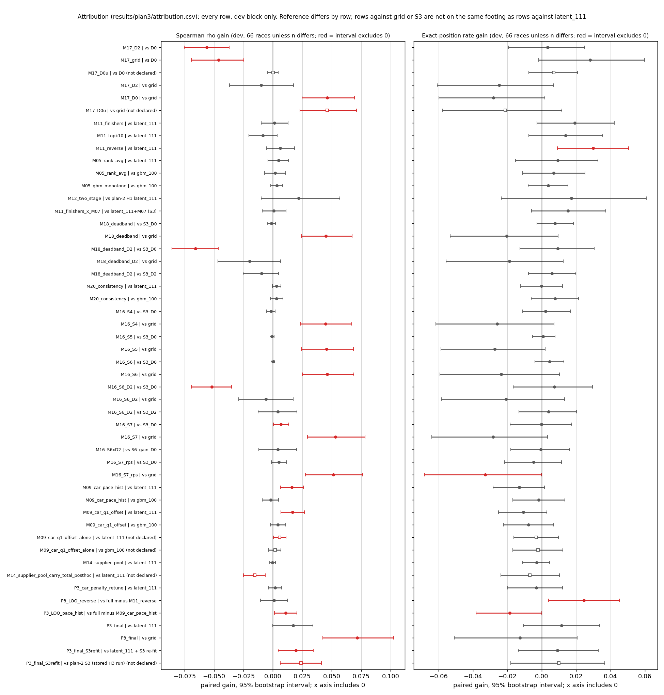
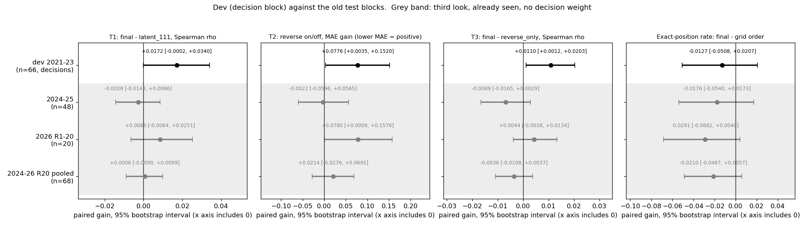
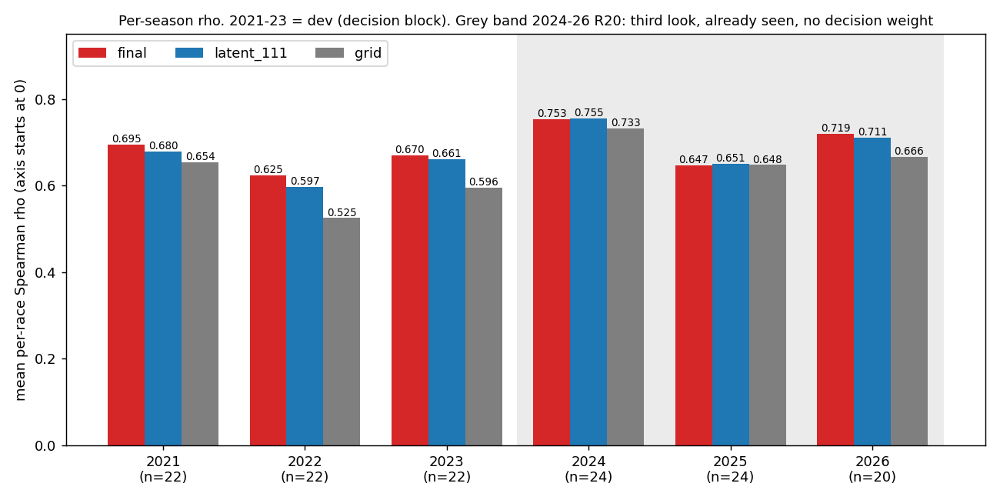

# Plan 3 report (R16): race pace, car development and a clean test

Generated by `results/plan3/make_report.py` at repository HEAD b890cd4 (plus uncommitted report files if any). Most numbers are read from files under `results/` or `methodologies/*/results/` (path next to the claim) or recomputed in the script. A few are typed values taken from `experiments/LOG.md` or method READMEs, each cited where used: Q5 (-0.0039 [-0.0174, +0.0095] and +0.010, LOG R10), Q8 (0.0005-0.0023, LOG R3), Q16 (0.132 and the +0.007 resolution, LOG R8), Q13 (11.8% and 16.4%, M17 README), and the Antonelli finding (A5 README). Nothing was re-run: no model fitted, nothing fetched.

## 0. Summary, failures first

- **There is no verdict on the plan-3 model.** The fresh holdout has n = 0 races (`holdout_status.json`: `verdict_state` = "no verdict (n < 20)"). Nothing can be called confirmed until 20 fresh races exist.
- **No evidence that the final plan-3 model beats `latent_111`.** Dev T1 (final - latent_111, rho) = +0.0172 [-0.0002, +0.0340], the lower bound is below 0 (`attribution.csv`, component P3_final, reference latent_111). On the already-seen 2024-26 R20 races the contrast is +0.0006 [-0.0090, +0.0099], n = 68 (`third_look.csv`, third look, already seen, no decision weight). The dev point estimate does not reappear; the dev interval was already not a clean pass and was selected on the same 66 races.
- **Grid order is not beaten on exact-position rate by any model, on dev or on the third look (no exact-vs-grid interval lies above 0 in either file).** Final minus grid, dev: -0.0127 [-0.0508, +0.0207] (`attribution.csv`, P3_final vs grid).
- **Q1 gate failed as declared; Q2 is a null.** The one dev gain that looked like race pace (M09) is credited by the pre-stated control to car form (section Q2).
- **Not tested:** Q3 (no verdict until 20 fresh races), Q7 (no permitted odds source), Q11 (rookie prior cut), Q17 (neural-network control not run), and parts of Q10 and Q16 (see sections).
- **Nothing in this report is a finding in the sense of PLAN3 §5**: a secondary result counts only if it also holds on the fresh holdout, and that holdout is empty.

### Verdict table

| Q | Question | Verdict |
|---|---|---|
| Q1 | Is race pace relative to qualifying pace persistent? | Not confirmed (gate failed as declared) |
| Q2 | Does an earlier-race pace offset improve the order? | Not confirmed (null) |
| Q3 | Do declared upgrades predict car strength? | Not tested (no verdict until 20 fresh races) |
| Q4 | Does a likelihood that down-weights the back of the field fit better? | Not confirmed |
| Q5 | Is two-stage (qualifying first) better before qualifying? | Not confirmed |
| Q6 | Does averaging latent and LightGBM help? | Not confirmed |
| Q7 | How do we compare with the betting market? | Not tested (M13 dropped) |
| Q8 | Do hyper-parameters tuned on 2021-23 go stale? | Not confirmed (no detectable staleness; low power) |
| Q9 | Are strengths believable, is every team shown? | Every team shown: done. Driver strengths believable: not confirmed |
| Q10 | Do car traits predict where a car is strong? | Supplier pooling not confirmed; trait x circuit and learned factors not tested |
| Q11 | Does a junior record help rookies? | Not tested (M15 cut) |
| Q12 | Do better noise models improve simulator probabilities? | Not confirmed |
| Q13 | Does exact-hit decoding beat score sorting? | Not confirmed |
| Q14 | Does a pace threshold for passing help? | Not confirmed (fitted threshold 0, component inactive) |
| Q15 | How fast does accuracy grow in the race? | Described on dev; the exact-rate target is not confirmed |
| Q16 | Do lap-level driver traits and pit-crew speed add anything? | Consistency not confirmed; the other traits not tested (failed persistence); crew time not run |
| Q17 | Does a small neural network do better? | Not tested (needs a rule change; not run) |

Reading rule used throughout: an interval that includes 0 is a null ("no measurable difference"), not a small gain. The plan's decision rule (PLAN3 §5) is a paired per-race 95% bootstrap interval on dev excluding 0; even then a secondary result is only "dev only" until the fresh holdout confirms it.

## Q1 - Is a car's race pace relative to its qualifying pace persistent? (A3 gate)
**Verdict: not confirmed.** The gate required a car-level persistence correlation of at least 0.2 on dev; it was 0.096 [0.016, 0.182] for the declared median-lap definition D1 and 0.119 [0.044, 0.207] for the fuel/stint-corrected D2 (`a3_summary.json` gate; `a3_persistence.csv`, car, half-life 50, dev). Both fail.
The other half of the gate passed: the extended oracle gap on finishers is 0.075 rho (`a3_oracle_gap.csv`, gap_med: 0.042 to 0.109), threshold 0.03. The model is below an oracle that knows each driver's race pace, but the offset relative to the best qualifying time does not persist enough to learn it.
**The null depends on a reference the plan did not fix (post hoc, no decision weight).** Against the Q1 gap instead of the best qualifying gap, car persistence is 0.268 [0.137, 0.454] (D1) and 0.393 [0.279, 0.511] (D2) (`a3_reference_sensitivity.csv`, variant "rq vs q1_gap (missing Q1 = NaN)"). With the car's own earlier race-pace gap controlled, the partial correlation falls to -0.004 [-0.128, 0.145] (D1) and 0.088 [0.019, 0.162] (D2). The persistent part is the car's race pace itself, not its offset from qualifying. These variants were chosen after the gate failed, so the gate outcome stands as declared. Source: `methodologies/A3_pace_persistence/README.md`; `experiments/LOG.md` R4 entry.

## Q2 - Does a race-pace offset learned from earlier races improve the order? (M09, primary hypothesis)
**Verdict: not confirmed.** The gate (Q1) failed, so M09 was not built as declared. Under PLAN3 Amendment 3 item 6 it was run afterwards as an exploratory component on a definition fixed beforehand (car race-pace history, then the Q1 offset); that was found after the gate failed, so a dev pass would be weaker evidence than a declared one.
- Dev, latent_111 + car pace history, rho: +0.0162 [+0.0065, +0.0258]; exact rate -0.0130 [-0.0283, +0.0015] (`attribution.csv`, M09_car_pace_hist vs latent_111). LightGBM, rho: -0.0020 [-0.0091, +0.0048] (vs gbm_100): null.
- The Q1-offset rung's bundle gain is +0.0168 [+0.0068, +0.0267]; its own increment over the history rung is not in `attribution.csv` as a separate row. The stored verdict text "passes alone" on rows M09_car_q1_offset and M09_car_q1_offset_alone refers to the bundle or to a non-declared off-ladder version and must not be read as the offset passing (README of M09 corrects it; the file is append-only).
- **Car-form control** (post hoc and diagnostic, no decision weight, but its decision rule was written to `control_prestatement.md` before its runs; `methodologies/M09_race_pace/results/control_paired_gains_dev.csv`): a column built the same way from the car's centred finishing position gives rho +0.0138 [+0.0027, +0.0245] against the reference; the race-pace column adds +0.0024 [-0.0006, +0.0055] beyond form alone (interval includes 0). Form alone lowers the exact rate, -0.0185 [-0.0348, -0.0026]. By the rule written before the control, the gain is credited to car form, not race pace.
- Holdout evidence so far: third look T3 (final - reverse_only, rho, 2024-26 R20 pooled) -0.0036 [-0.0108, +0.0037] (n=68) (third look, already seen, no decision weight). The fresh holdout T3 decides what, if anything, M09 contributes.

## Q3 - Do declared car upgrades predict changes in car strength? (M10)
**Verdict: not tested. M10 has no verdict until 20 fresh holdout races.** There is no dev data (FIA car-presentation documents start at 2024 round 2; `methodologies/M10_upgrades/README.md`, "Coverage"). One rung (total declared-component count, `lam_x` fixed at 1.0) is built and pre-registered; the verdict test is mean rho at H1, with H2 a negative control, and nothing is scored. Expected gain per the amendment: about 0 at H2, at most 0.01 rho at H0/H1; failure is an interval including 0. PLAN3 §M10's "covers 2022 onward" is contradicted by the data and was not edited (M10 README).

## Q4 - Does a likelihood that ignores or down-weights the noisy back of the field fit better? (M11)
**Verdict: not confirmed** for the two variants that match the question (finishers-only, top-10). The third variant, reverse (built from last place upward), is a different mechanism and is carried as a dev-only candidate.

| variant (vs latent_111, dev, 66 races) | rho gain | MAE gain (ref - cand) | exact-rate gain |
|---|---|---|---|
| finishers-only | +0.0014 [-0.0100, +0.0130] | +0.065 [-0.005, +0.134] | +0.0193 [-0.0028, +0.0422] |
| top-10 | -0.0085 [-0.0205, +0.0036] | -0.007 [-0.083, +0.071] | +0.0138 [-0.0074, +0.0355] |
| reverse | +0.0062 [-0.0053, +0.0184] | +0.076 [+0.007, +0.147] | +0.0300 [+0.0092, +0.0506] |

Source: `attribution.csv`, rows M11_*. For reverse, the MAE and exact intervals exclude 0 while rho does not; LOG R5 records that the overall MAE and exact-rate gains do not survive a Holm correction over the 36 intervals of that package. Reverse is inside the final model and holdout test T2 (MAE) tests it; third look T2 pooled: +0.0214 [-0.0276, +0.0695] (n=68) (third look, already seen, no decision weight). Interaction finishers-only x retirement model (M07): RPS +0.0007 [-0.0015, +0.0029], null.

## Q5 - Before qualifying, is "predict qualifying, then the race" better than predicting the race directly? (M12)
**Verdict: not confirmed.** Two-stage minus plan-2 H1, rho +0.0218 [-0.0101, +0.0569], MAE +0.182 [-0.034, +0.391], n = 21 races of 2023 (practice data exist only from 2023) (`attribution.csv`, M12_two_stage). Both intervals include 0. LOG R10 records that the point estimate rests on one race (without race 185 it is +0.010) and that the 44 races of 2021-22 (stage 1 from history only) are also null (rho -0.0039 [-0.0174, +0.0095]); that row is not in `attribution.csv` and is not re-derived here.

## Q6 - Does averaging the latent model and LightGBM help? (M05)
**Verdict: not confirmed.** Rank average vs latent_111, rho +0.0048 [-0.0042, +0.0133]; vs gbm_100 +0.0019 [-0.0070, +0.0110]; monotone LightGBM vs gbm_100 +0.0033 [-0.0017, +0.0082] (`attribution.csv`, M05_*). The M05 README records a points log-loss gain over latent_111 that is not there against gbm_100, so the ensemble is not better than LightGBM alone.

## Q7 - How do we compare with the betting market? (M13)
**Verdict: not tested.** M13 was dropped on 2026-11-18: no source with clearly permitted automated use (Polymarket terms ambiguous, Betfair keys for own betting, Kalshi unreachable, The Odds API has no F1). Nothing was collected or stored (`methodologies/M13_market_benchmark/README.md`; LOG R17 entry).

## Q8 - Do hyper-parameters tuned once on 2021-23 go stale, and how does accuracy move season by season? (A4)
**Verdict: not confirmed.** Re-tuning the hyper-parameters on the three seasons before each season does not beat the fixed 2021-23 settings on dev: latent_111 rho -0.0037 [-0.0104, +0.0029], gbm_100 rho +0.0005 [-0.0059, +0.0068] (delta = rolling - fixed; `a4_summary.json`, retune). Decision recorded there: "keep hyper-parameters tuned on 2021-23". One of the six paired tests excludes 0 and it points against rolling: latent MAE worse by +0.043 [+0.006, +0.081], all from 2022 (README of A4). Low power: the two tuned settings differed in one season (latent) or two (LightGBM), and the settings that won their tuning windows did so by 0.0005-0.0023 rho (LOG R3 entry); the test mostly measures noise in picking among near-tied settings, and it cannot speak to staleness under a regime change larger than 2022.

Season by season (every race predicted from earlier races only; seasons before 2021 are labelled "not clean" because the hyper-parameters were tuned on later data; model minus qualifying order, rho, paired by race; `a4_gain_over_qualifying.csv`):

| block | latent_111 - qualifying | gbm_100 - qualifying |
|---|---|---|
| 2015-20 (not clean) | +0.009 [-0.000, +0.018], n=119 | +0.017 [+0.003, +0.032], n=119 |
| dev 2021-23 | +0.029 [+0.011, +0.047], n=66 | +0.032 [+0.011, +0.053], n=66 |
| 2024-26 (third look) | +0.002 [-0.008, +0.012], n=68 | -0.001 [-0.018, +0.018], n=68 |
| all seasons | +0.012 [+0.005, +0.019], n=253 | +0.016 [+0.006, +0.027], n=253 |
| all seasons except 2017 and 2023 | +0.005 [-0.004, +0.014], n=211 | +0.009 [-0.001, +0.019], n=211 |

Reading: the gain over qualifying order is small everywhere, largest on the block the settings were tuned on, and without 2017 and 2023 the pooled gain is not distinguishable from 0 (row "all except 2017, 2023"). There is no trend over seasons (latent slope +0.0007 per season [-0.0031, +0.0045], p = 0.72). The first-half/second-half difference in the README was found after looking and carries no weight. 2024-26 is a third look (third look, already seen, no decision weight). Season table: `season_table.csv`; figures `figures/a4_season_table.png`, `figures/a4_gain_over_qualifying.png`.

## Q9 - Are the estimated driver and car strengths believable, and is every team shown? (A5)
**Verdict, part 1 (is every team shown): done.** All 13 car lineages are in every car table and figure of the audit (`a5_summary.json`: n_lineages_plotted = 13); the plan-1 "largest 8" filter was a plotting bug that dropped McLaren, Haas, Cadillac, Manor and Caterham. The table and figure below show all 13.
**Verdict, part 2 (are the driver strengths believable): not confirmed.** Evidence:
- Out-of-sample teammate check (strength at the end of season S-1 against the teammate finishing gap in S, 92 pairs): qualifying-in model r = +0.276 [+0.013, +0.490], history-only (H0) r = +0.387 [+0.142, +0.589] (`a5_summary.json`, teammate_oos_pooled; per season `teammate_oos.csv`: 4 of 12 seasons are negative for the qualifying-in model and almost every single-season interval spans 0, 5-9 pairs each). This is well below the in-sample +0.538 and +0.615; in-sample car correlation 0.920 (`pooled_correlations`).
- Driver pairs that can be separated: 0.6% of 325 pairs among 26 drivers in the qualifying-in model, 10.5% in H0 (`a5_summary.json`, resolved_pairs; `resolved_pairs.csv`). With qualifying in the model the driver term `a` is a race-day gain beyond grid slot, not overall skill; the H0 table is the overall-skill one.
- Identification: 21 of 65 drivers are weakly identified (fewer than two teammates or disconnected); 8 have fewer than 10 starts (`a5_summary.json`, identification; `identification.csv`).
- One-race drivers at the extremes: the shrinkage cause is the driver penalty (lam 32, implied prior sd 0.125) being much wider than the spread of established drivers, not a bug. In the unseparated final-fit ranking of the qualifying-in model, 2 of 6 extreme slots are one-race drivers (rafael_camara, ryo_hirakawa); across season-end snapshots 5 of 78 slots (`acceptance_summary.csv`). The acceptance check passes only because low-start drivers are shown in a separate panel (main panel: 0 low-sample drivers in the extremes). The stronger penalty (lam_a) variant that removes them was not adopted for prediction (README of A5).
- Face validity (A5 README, near line 170, typed from there): Antonelli 2026 is a face-validity failure of the static driver term: 44 starts, H0 rank 17/25 (`champion_ranks.csv`) and below his teammate (rank 10) although he outscored him in 2026 points; the cause given is the static `a` with a 50-race half-life dominated by 2025. The 2026 row is the points leader after R20, season not finished, so it is a check of the model, not of a champion. Norris 2025 is ranked 5/21 in the qualifying-in model (`champion_ranks.csv`). Whether the 2026 order is right is unverified here.

### All 13 car lineages (final fit, last season in the data; `cars_final_fit.csv`)

| lineage | last season | H0 strength [95% interval] | qualifying-in strength [95% interval] | rows that season |
|---|---|---|---|---|
| mercedes | 2026 | +0.252 [+0.109, +0.395] | +0.116 [-0.029, +0.262] | 40 |
| ferrari | 2026 | +0.185 [+0.058, +0.312] | +0.077 [-0.052, +0.205] | 40 |
| mclaren | 2026 | +0.158 [+0.003, +0.312] | +0.067 [-0.088, +0.223] | 37 |
| red_bull | 2026 | +0.071 [-0.055, +0.198] | +0.047 [-0.080, +0.174] | 40 |
| rb_lineage | 2026 | +0.068 [-0.073, +0.209] | +0.052 [-0.089, +0.193] | 39 |
| caterham | 2014 | -0.049 [-0.273, +0.176] | -0.024 [-0.248, +0.201] | 33 |
| sauber_lineage | 2026 | -0.052 [-0.193, +0.090] | -0.014 [-0.156, +0.128] | 38 |
| alpine_lineage | 2026 | -0.071 [-0.204, +0.062] | -0.068 [-0.201, +0.065] | 40 |
| haas | 2026 | -0.131 [-0.264, +0.001] | -0.067 [-0.200, +0.067] | 40 |
| manor_lineage | 2016 | -0.168 [-0.415, +0.079] | -0.080 [-0.328, +0.168] | 42 |
| williams | 2026 | -0.228 [-0.355, -0.101] | -0.123 [-0.251, +0.006] | 39 |
| aston_lineage | 2026 | -0.245 [-0.380, -0.110] | -0.118 [-0.255, +0.019] | 40 |
| cadillac | 2026 | -0.249 [-0.366, -0.133] | -0.103 [-0.223, +0.016] | 39 |

Intervals are conditional on sigma = 0.25 and the decay-weighted likelihood; coverage was not verified; all strengths are in-sample descriptions (A5 README). Figure: `figures/r16_all_lineages_car_strength.png`. caterham (2014) and manor_lineage (2016) are shown at their last season and are not comparable to the 2026 cars; all values are in-sample.

### Drivers active in 2026, H0 (overall-skill) fit, all of them (`drivers_final_fit.csv`)

| driver | starts (all time in data) | H0 skill [95% interval] | flag |
|---|---|---|---|
| max_verstappen | 253 | +0.206 [+0.110, +0.302] |  |
| norris | 170 | +0.088 [-0.038, +0.215] |  |
| leclerc | 191 | +0.076 [-0.024, +0.175] |  |
| hamilton | 271 | +0.059 [-0.038, +0.157] |  |
| hadjar | 41 | +0.058 [-0.064, +0.180] |  |
| sainz | 249 | +0.054 [-0.040, +0.149] |  |
| gasly | 197 | +0.049 [-0.049, +0.146] |  |
| ryo_hirakawa | 1 | +0.048 [-0.173, +0.270] | fewer than 10 starts |
| piastri | 88 | +0.038 [-0.101, +0.176] |  |
| russell | 172 | +0.031 [-0.078, +0.141] |  |
| albon | 147 | +0.031 [-0.070, +0.132] |  |
| alonso | 229 | +0.030 [-0.077, +0.137] |  |
| hulkenberg | 212 | +0.017 [-0.088, +0.123] |  |
| lawson | 55 | +0.008 [-0.107, +0.123] |  |
| ocon | 198 | +0.006 [-0.091, +0.104] |  |
| bearman | 47 | -0.003 [-0.125, +0.120] |  |
| antonelli | 44 | -0.004 [-0.140, +0.132] |  |
| perez | 245 | -0.009 [-0.107, +0.089] |  |
| colapinto | 46 | -0.011 [-0.130, +0.107] |  |
| bortoleto | 43 | -0.021 [-0.153, +0.112] |  |
| arvid_lindblad | 19 | -0.024 [-0.174, +0.127] |  |
| rafael_camara | 1 | -0.054 [-0.275, +0.167] | fewer than 10 starts |
| bottas | 246 | -0.056 [-0.156, +0.044] |  |
| stroll | 209 | -0.083 [-0.191, +0.025] |  |
| tsunoda | 115 | -0.085 [-0.187, +0.017] |  |

### Champion (2026: points leader after R20, season not finished) and the champion's teammate, season-end rank (`champion_ranks.csv`)

| season | qual-in: champion rank | qual-in: teammate rank | H0: champion rank | H0: teammate rank |
|---|---|---|---|---|
| 2014 | hamilton 1/24 | rosberg 7/24 | hamilton 1/24 | rosberg 4/24 |
| 2015 | hamilton 1/21 | rosberg 8/21 | hamilton 1/21 | rosberg 3/21 |
| 2016 | rosberg 5/24 | hamilton 1/24 | rosberg 2/24 | hamilton 1/24 |
| 2017 | hamilton 1/25 | bottas 3/25 | hamilton 1/25 | bottas 2/25 |
| 2018 | hamilton 1/20 | bottas 5/20 | hamilton 1/20 | bottas 3/20 |
| 2019 | hamilton 1/20 | bottas 4/20 | hamilton 1/20 | bottas 3/20 |
| 2020 | hamilton 1/23 | bottas 8/23 | hamilton 1/23 | bottas 3/23 |
| 2021 | max_verstappen 2/21 | perez 4/21 | max_verstappen 2/21 | perez 9/21 |
| 2022 | max_verstappen 1/22 | perez 7/22 | max_verstappen 1/22 | perez 9/22 |
| 2023 | max_verstappen 1/22 | perez 8/22 | max_verstappen 1/22 | perez 12/22 |
| 2024 | max_verstappen 1/24 | perez 18/24 | max_verstappen 1/24 | perez 20/24 |
| 2025 | norris 5/21 | piastri 10/21 | norris 3/21 | piastri 9/21 |
| 2026 (points leader after R20, season not finished) | antonelli 16/25 | russell 17/25 | antonelli 17/25 | russell 10/25 |

## Q10 - Do measurable car traits predict where a car is strong? (M14)
**Verdict: not confirmed for engine-supplier pooling (the only part run). Trait x circuit and learned car x circuit factors (R11 parts 2-3): not tested; they were cut** under the PLAN3 §6 cut order by a main-session decision on 2026-11-18 (`experiments/LOG.md`, R17 entry; the M14 README status line was written earlier and still says they are not cut).
- Supplier pooling, dev: rho -0.0003 [-0.0027, +0.0022], exact -0.0030 [-0.0113, +0.0047] (`attribution.csv`, M14_supplier_pool). The fitted penalty sits at the grid edge, i.e. the data switch the supplier term off. Dev contains one chassis change (2022) and one engine rebadge, so little could be shown; this was stated in advance.
- Post-hoc variant (form chosen after the declared result; confounded with an own-part ridge): rho -0.0155 [-0.0249, -0.0066], worse. It carries no decision weight and is not evidence against pooling.
- The motivating case (new power-unit rules in 2026) lies in the already-seen block and was not used. The component is not in the final model.

## Q11 - Does a junior-series record give a better starting estimate for a rookie? (M15)
**Verdict: not tested.** M15 was cut in PLAN3 Amendment 3 item 4: 8 debuts in dev would give an uninformative interval, and mid-season debuts need care to avoid leakage. No folder, run or file exists for it.

## Q12 - Do better noise models improve the simulator's probabilities? (M16)
**Verdict: not confirmed.** RPS gain over S3 (dev, 66 races; positive = lower RPS):

| step | RPS gain vs S3 [95% interval] |
|---|---|
| S4 Henery stage multipliers | +0.00007 [-0.00019, +0.00034] |
| S5 team shock / normal noise | +0.00010 [-0.00027, +0.00049] |
| S6 Laplace interval width | +0.00005 [-0.00006, +0.00016] |
| S7 AR latent, Spearman-picked (superseded) | +0.00031 [-0.00072, +0.00137] |
| S7 AR latent, RPS-picked (declared) | +0.00057 [-0.00024, +0.00143] |

Source: `attribution.csv`, M16_* vs S3_D0. Every interval includes 0. The declared interaction S6 x D2 on exact rate is also null (-0.0006 [-0.0179, +0.0162]). The M16 README records that the fitted settings sit at or near neutral (the S5 tuning switches every extension off; S7 phi at the grid edge) and that the plan's hoped-for 0.0012-0.0036 RPS gain was not reached. Secondary intervals that exclude 0 in that package (top-10 and both-cars log-loss, driven by 2023) are not passes. Separately, re-fitting S3 on the final model's scores (not a variant search) gives an RPS gain over the same re-fit of latent_111 of +0.00518 [+0.00294, +0.00742] on dev, in-sample for both fits; on the third look it is +0.00085 [-0.00063, +0.00234] (n=68) (third look, already seen, no decision weight).

## Q13 - Does choosing the predicted order to maximise expected exact hits beat sorting by score? (M17)
**Verdict: not confirmed.** Exact-position rate, dev, 66 races: D2 minus D0 +0.0033 [-0.0193, +0.0249]; D2 minus grid order -0.0248 [-0.0607, +0.0069]; D0 minus grid -0.0281 [-0.0598, +0.0018] (`attribution.csv`, M17_*). The pre-stated failure criterion (D2 not above grid) is met. D2 costs ordering quality: rho -0.0562 [-0.0753, -0.0371], MAE -0.216 [-0.322, -0.107]. The M17 README locates the cause in the simulator's matrix (11.8% mass on "finishes in the grid slot" against 16.4% realised), not in the decoder; the earlier plan statement that sorting is the wrong decoder was corrected there. Grid-slot calibration failed for every later matrix (LOG R12 entry), so D2 was run only for the declared S6 x D2.

## Q14 - Does a pace threshold for passing improve on a linear pace effect? (M18)
**Verdict: not confirmed.** Because Q1's gate failed there is no pace offset, so the dead-band was applied to the model's strength difference inside the plan-2 simulator. The d fitted by RPS on dev is 0, i.e. the component is inactive; the best positive d tried (0.03) gives, against S3 D0, rho -0.0013 [-0.0048, +0.0022], exact +0.0077 [-0.0028, +0.0184], RPS -0.00010 [-0.00042, +0.00022]: no measurable difference (`attribution.csv`, M18_deadband). Against grid order on exact rate: -0.0204 [-0.0532, +0.0094]. The M18 README gives the mechanism: a dead-band can only pull the model toward grid order, so it cannot beat grid order on exact rate under any objective. LOG R7 records that the RPS objective could not be verified as chosen before running, and that plan 2 had already fitted the linear grid-attachment term to 0 on the same simulator.

## Q15 - How fast does accuracy grow once the race is running? (M19, reported separately from pre-race results)
**Verdict: described on dev; the exact-rate target is not confirmed.** The running order itself is the baseline at each horizon. Dev, 66 races, paired gain over the running order (`methodologies/M19_inrace/results/paired_gains_dev.csv`, subset all_66, models latent_s2 / gbm_s2; this is the literal-reading final version, run ids `20261117-0225_m19v2b_*`):

| horizon | model | running-order exact | model exact | rho gain [95%] | exact-rate gain [95%] |
|---|---|---|---|---|---|
| H4 (after lap 1) | latent | 0.191 | 0.153 | +0.028 [+0.011, +0.047] | -0.038 [-0.071, -0.008] |
| H4 (after lap 1) | gbm | 0.191 | 0.168 | +0.039 [+0.024, +0.056] | -0.023 [-0.054, +0.006] |
| H5 (25% of distance) | latent | 0.244 | 0.213 | +0.028 [+0.013, +0.044] | -0.031 [-0.067, +0.003] |
| H5 (25% of distance) | gbm | 0.244 | 0.220 | +0.030 [+0.015, +0.048] | -0.024 [-0.062, +0.014] |
| H6 (50% of distance) | latent | 0.313 | 0.296 | +0.012 [+0.003, +0.020] | -0.016 [-0.050, +0.015] |
| H6 (50% of distance) | gbm | 0.313 | 0.264 | +0.010 [+0.004, +0.018] | -0.049 [-0.083, -0.017] |

Reading: adding in-race state to the pre-race score raises rho over the running order at every horizon (all six intervals exclude 0; dev only, secondary, not tested on the fresh holdout, and LOG R13 records that the H4/H5 gains come from 2022-23, 2021 being null, and the M19 README that H6 is marginal), but exact-position rate is below the running order at all six pairs (two intervals exclude 0), because sorting by score moves cars off the place they hold. The Amendment-2 target of 25% by quarter distance is not reached by the model (H5 column above); the running order itself is the better exact-rate predictor. In-race numbers are never to be compared with pre-race ones without the horizon.

## Q16 - Do lap-level driver traits and pit-crew speed add anything? (M20)
**Verdict: not confirmed for driver consistency (the only trait run in a model); tyre degradation, lap-1 gain and slow-stop rate were not tested (they failed the persistence check and were not run); crew time loss was not run.**

| feature | persistence on dev (rule: >= 0.2 on the point estimate) [95%] | passes rule | model run? |
|---|---|---|---|
| driver consistency | 0.256 [0.153, 0.355] | yes | run |
| driver tyre degradation | 0.121 [0.058, 0.177] | no | not run |
| driver lap-1 gain | 0.163 [0.107, 0.220] | no | not run |
| pit-crew time loss (team) | 0.186 [0.102, 0.282] | no | not run |
| pit-crew slow-stop rate (team) | 0.119 [0.036, 0.204] | no | not run |

Source: `results/plan3/m20_summary.json`, decision. Driver consistency in the model, dev: rho +0.0030 [-0.0005, +0.0067] vs latent_111 and +0.0031 [-0.0022, +0.0085] vs gbm_100; MAE and exact rate null for both (`attribution.csv`, M20_consistency). That is the pre-stated failure. The persistence decisions are fragile (LOG R8 entry, skeptic review): consistency tracks grid position within a race (0.132 after partialling out the grid), and crew time loss fails the 0.2 rule on the point estimate but about half the reasonable variants are at or above it. Dev cannot distinguish 0 from about +0.007 rho, two to three times the expected effect (LOG R8 phase 2).

## Q17 - Does a small neural network do better than the current models on the same inputs? (M21)
**Verdict: not tested.** M21 runs only if the "no neural networks" rule in `CLAUDE.md` is relaxed for this one control (PLAN3 §4, M21). The rule has not been relaxed and no M21 code, folder or run exists.

## 1. Attribution table (`results/plan3/attribution.csv`, all rows, dev block)

Each row is one component against one reference on the 66 dev races (21 for M12). Gains are candidate minus reference for rho and exact rate; MAE gain is reference minus candidate. "Excl. 0" is computed here from the interval (lower bound above 0 or upper bound below 0 on the rho column); the stored `verdict` is the text written at the time. Rows for M17, M16, M18 use references D0, S3 or grid, so their rho/exact columns are not comparable with rows against latent_111. Rows with declared = no are post hoc or diagnostic. The file is append-only; stored verdict texts are shown unedited, and where later work contradicts one it is noted below the table.

| # | component | reference | declared | rho gain [95%] | excl. 0 (rho) | MAE gain [95%] | exact gain [95%] | RPS gain [95%] | leave-one-out | n | stored verdict |
|---|---|---|---|---|---|---|---|---|---|---|---|
| 0 | M17_D2 | D0 | yes | -0.0562 [-0.0753, -0.0371] | yes | -0.216 [-0.322, -0.107] | +0.0033 [-0.0193, +0.0249] |  |  | 66 | no measurable difference |
| 1 | M17_grid | D0 | yes | -0.0462 [-0.0692, -0.0247] | yes | -0.178 [-0.321, -0.040] | +0.0281 [-0.0018, +0.0598] |  |  | 66 | no measurable difference |
| 2 | M17_D0u | D0 | no | +0.0001 [-0.0044, +0.0044] | no | +0.012 [-0.027, +0.051] | +0.0069 [-0.0074, +0.0207] |  |  | 66 | no measurable difference |
| 3 | M17_D2 | grid | yes | -0.0099 [-0.0368, +0.0177] | no | -0.037 [-0.202, +0.126] | -0.0248 [-0.0607, +0.0069] |  |  | 66 | no measurable difference |
| 4 | M17_D0 | grid | yes | +0.0462 [+0.0247, +0.0692] | yes | +0.178 [+0.040, +0.321] | -0.0281 [-0.0598, +0.0018] |  |  | 66 | no measurable difference |
| 5 | M17_D0u | grid | no | +0.0463 [+0.0231, +0.0709] | yes | +0.191 [+0.033, +0.350] | -0.0212 [-0.0577, +0.0116] |  |  | 66 | no measurable difference |
| 6 | M11_finishers | latent_111 | yes | +0.0014 [-0.0100, +0.0130] | no | +0.065 [-0.005, +0.134] | +0.0193 [-0.0028, +0.0422] |  |  | 66 | rho: none; MAE: none; exact: none; dev only |
| 7 | M11_topk10 | latent_111 | yes | -0.0085 [-0.0205, +0.0036] | no | -0.007 [-0.083, +0.071] | +0.0138 [-0.0074, +0.0355] |  |  | 66 | rho: none; MAE: none; exact: none; dev only |
| 8 | M11_reverse | latent_111 | yes | +0.0062 [-0.0053, +0.0184] | no | +0.076 [+0.007, +0.147] | +0.0300 [+0.0092, +0.0506] |  |  | 66 | rho: none; MAE: gain; exact: gain; dev only |
| 9 | M05_rank_avg | latent_111 | yes | +0.0048 [-0.0042, +0.0133] | no | +0.052 [-0.012, +0.117] | +0.0093 [-0.0152, +0.0326] |  |  | 66 | no measurable difference |
| 10 | M05_rank_avg | gbm_100 | yes | +0.0019 [-0.0070, +0.0110] | no | +0.034 [-0.026, +0.092] | +0.0069 [-0.0112, +0.0252] |  |  | 66 | no measurable difference |
| 11 | M05_gbm_monotone | gbm_100 | yes | +0.0033 [-0.0017, +0.0082] | no | +0.018 [-0.012, +0.049] | +0.0037 [-0.0079, +0.0153] |  |  | 66 | no measurable difference |
| 12 | M12_two_stage | plan2_H1_latent_111 | yes | +0.0218 [-0.0101, +0.0569] | no | +0.182 [-0.034, +0.391] | +0.0172 [-0.0236, +0.0608] |  |  | 21 | no measurable difference |
| 13 | M11_finishers_x_M07 | latent_111+M07 (S3) | yes | +0.0007 [-0.0092, +0.0111] | no | +0.047 [-0.011, +0.108] | +0.0154 [-0.0059, +0.0372] | +0.00071 [-0.00150, +0.00291] |  | 66 | RPS: none; rho: none; MAE: none; exact: none; dev only |
| 14 | M18_deadband | S3_D0 | yes | -0.0013 [-0.0048, +0.0022] | no | +0.008 [-0.016, +0.034] | +0.0077 [-0.0028, +0.0184] | -0.00010 [-0.00042, +0.00022] |  | 66 | fitted d = 0 (RPS objective); component inactive; best positive d = 0.03: no measurable difference |
| 15 | M18_deadband | grid | yes | +0.0449 [+0.0242, +0.0673] | yes | +0.186 [+0.053, +0.324] | -0.0204 [-0.0532, +0.0094] |  |  | 66 | fitted d = 0 (RPS objective); component inactive; best positive d = 0.03: no measurable difference (rps and log-loss columns blank: they compared S3 vs d = 0.03 and are not defined against grid order) |
| 16 | M18_deadband_D2 | S3_D0 | yes | -0.0659 [-0.0857, -0.0465] | yes | -0.221 [-0.322, -0.119] | +0.0093 [-0.0127, +0.0306] | -0.00010 [-0.00042, +0.00022] |  | 66 | fitted d = 0 (RPS objective); component inactive; best positive d = 0.03: no measurable difference |
| 17 | M18_deadband_D2 | grid | yes | -0.0197 [-0.0467, +0.0067] | no | -0.043 [-0.204, +0.118] | -0.0189 [-0.0555, +0.0126] |  |  | 66 | fitted d = 0 (RPS objective); component inactive; best positive d = 0.03: no measurable difference (rps and log-loss columns blank: they compared S3 vs d = 0.03 and are not defined against grid order) |
| 18 | M18_deadband_D2 | S3_D2 | yes | -0.0098 [-0.0253, +0.0047] | no | -0.006 [-0.083, +0.067] | +0.0059 [-0.0077, +0.0199] | -0.00010 [-0.00042, +0.00022] |  | 66 | fitted d = 0 (RPS objective); component inactive; best positive d = 0.03: no measurable difference |
| 19 | M20_consistency | latent_111 | yes | +0.0030 [-0.0005, +0.0067] | no | +0.015 [-0.013, +0.042] | -0.0001 [-0.0123, +0.0120] |  |  | 66 | no measurable difference |
| 20 | M20_consistency | gbm_100 | yes | +0.0031 [-0.0022, +0.0085] | no | +0.018 [-0.025, +0.063] | +0.0077 [-0.0061, +0.0214] |  |  | 66 | no measurable difference |
| 21 | M16_S4 | S3_D0 | yes | -0.0015 [-0.0054, +0.0020] | no | -0.015 [-0.038, +0.006] | +0.0023 [-0.0111, +0.0166] | +0.00007 [-0.00019, +0.00034] |  | 66 | no measurable difference |
| 22 | M16_S4 | grid | yes | +0.0447 [+0.0236, +0.0669] | yes | +0.163 [+0.021, +0.308] | -0.0258 [-0.0616, +0.0072] | +0.00007 [-0.00019, +0.00034] |  | 66 | no measurable difference |
| 23 | M16_S5 | S3_D0 | yes | -0.0007 [-0.0024, +0.0009] | no | -0.007 [-0.021, +0.006] | +0.0008 [-0.0053, +0.0077] | +0.00010 [-0.00027, +0.00049] |  | 66 | no measurable difference |
| 24 | M16_S5 | grid | yes | +0.0455 [+0.0241, +0.0686] | yes | +0.171 [+0.035, +0.311] | -0.0273 [-0.0586, +0.0020] | +0.00010 [-0.00027, +0.00049] |  | 66 | no measurable difference |
| 25 | M16_S6 | S3_D0 | yes | +0.0000 [-0.0015, +0.0016] | no | +0.003 [-0.012, +0.018] | +0.0045 [-0.0039, +0.0129] | +0.00005 [-0.00006, +0.00016] |  | 66 | no measurable difference |
| 26 | M16_S6 | grid | yes | +0.0463 [+0.0250, +0.0688] | yes | +0.181 [+0.042, +0.323] | -0.0236 [-0.0591, +0.0104] | +0.00005 [-0.00006, +0.00016] |  | 66 | no measurable difference |
| 27 | M16_S6_D2 | S3_D0 | yes | -0.0520 [-0.0694, -0.0351] | yes | -0.158 [-0.252, -0.062] | +0.0073 [-0.0166, +0.0295] | +0.00005 [-0.00006, +0.00016] |  | 66 | no measurable difference |
| 28 | M16_S6_D2 | grid | yes | -0.0058 [-0.0291, +0.0174] | no | +0.020 [-0.136, +0.175] | -0.0208 [-0.0584, +0.0132] | +0.00005 [-0.00006, +0.00016] |  | 66 | no measurable difference |
| 29 | M16_S6_D2 | S3_D2 | yes | +0.0041 [-0.0125, +0.0205] | no | +0.057 [-0.037, +0.148] | +0.0040 [-0.0133, +0.0201] | +0.00005 [-0.00006, +0.00016] |  | 66 | no measurable difference |
| 30 | M16_S7 | S3_D0 | yes | +0.0069 [+0.0004, +0.0134] | yes | +0.018 [-0.035, +0.070] | -0.0002 [-0.0184, +0.0174] | +0.00031 [-0.00072, +0.00137] |  | 66 | no measurable difference |
| 31 | M16_S7 | grid | yes | +0.0531 [+0.0293, +0.0783] | yes | +0.196 [+0.033, +0.363] | -0.0283 [-0.0639, +0.0034] | +0.00031 [-0.00072, +0.00137] |  | 66 | no measurable difference |
| 32 | M16_S6xD2 | S6_gain_D0 | yes | +0.0041 [-0.0121, +0.0202] | no | +0.054 [-0.038, +0.143] | -0.0006 [-0.0179, +0.0162] |  |  | 66 | no measurable difference |
| 33 | M16_S7_rps | S3_D0 | yes | +0.0050 [-0.0012, +0.0114] | no | +0.015 [-0.036, +0.066] | -0.0047 [-0.0215, +0.0116] | +0.00057 [-0.00024, +0.00143] |  | 66 | no measurable difference |
| 34 | M16_S7_rps | grid | yes | +0.0513 [+0.0278, +0.0762] | yes | +0.194 [+0.031, +0.359] | -0.0328 [-0.0680, -0.0002] | +0.00057 [-0.00024, +0.00143] |  | 66 | worse |
| 35 | M09_car_pace_hist | latent_111 | yes | +0.0162 [+0.0065, +0.0258] | yes | +0.042 [-0.023, +0.106] | -0.0130 [-0.0283, +0.0015] |  |  | 66 | passes alone |
| 36 | M09_car_pace_hist | gbm_100 | yes | -0.0020 [-0.0091, +0.0048] | no | -0.019 [-0.065, +0.030] | -0.0018 [-0.0169, +0.0135] |  |  | 66 | no measurable difference |
| 37 | M09_car_q1_offset | latent_111 | yes | +0.0168 [+0.0068, +0.0267] | yes | +0.045 [-0.022, +0.110] | -0.0107 [-0.0251, +0.0029] |  |  | 66 | passes alone |
| 38 | M09_car_q1_offset | gbm_100 | yes | +0.0043 [-0.0020, +0.0109] | no | +0.007 [-0.041, +0.056] | -0.0077 [-0.0220, +0.0069] |  |  | 66 | no measurable difference |
| 39 | M09_car_q1_offset_alone | latent_111 | no | +0.0057 [+0.0006, +0.0111] | yes | +0.013 [-0.023, +0.049] | -0.0031 [-0.0161, +0.0097] |  |  | 66 | passes alone |
| 40 | M09_car_q1_offset_alone | gbm_100 | no | +0.0018 [-0.0036, +0.0069] | no | +0.006 [-0.030, +0.041] | -0.0022 [-0.0168, +0.0122] |  |  | 66 | no measurable difference |
| 41 | M14_supplier_pool | latent_111 | yes | -0.0003 [-0.0027, +0.0022] | no | -0.009 [-0.026, +0.006] | -0.0030 [-0.0113, +0.0047] |  |  | 66 | no measurable difference |
| 42 | M14_supplier_pool_carry_total_posthoc | latent_111 | no | -0.0155 [-0.0249, -0.0066] | yes | -0.074 [-0.131, -0.021] | -0.0069 [-0.0236, +0.0104] |  |  | 66 | worse |
| 43 | P3_car_penalty_retune | latent_111 | yes | +0.0019 [-0.0040, +0.0074] | no | -0.017 [-0.054, +0.019] | -0.0031 [-0.0199, +0.0121] |  |  | 66 | lam_car 16 (lam_a 32): spearman: none; mae: none; exact: none; dev only |
| 44 | P3_LOO_reverse | leave-one-out: full (M11_reverse+M09_car_pace_hist) vs full minus M11_reverse | yes | +0.0010 [-0.0105, +0.0124] | no | +0.078 [+0.004, +0.152] | +0.0245 [+0.0040, +0.0452] |  | spearman +0.0010 [-0.0105, +0.0124]; mae +0.0776 [+0.0035, +0.1520]; exact +0.0245 [+0.0040, +0.0452] | 66 | retained (round 1); dev only |
| 45 | P3_LOO_pace_hist | leave-one-out: full (M11_reverse+M09_car_pace_hist) vs full minus M09_car_pace_hist | yes | +0.0110 [+0.0012, +0.0203] | yes | +0.043 [-0.025, +0.110] | -0.0185 [-0.0382, -0.0000] |  | spearman +0.0110 [+0.0012, +0.0203]; mae +0.0435 [-0.0249, +0.1096]; exact -0.0185 [-0.0382, -0.0000] | 66 | retained (round 1) on rho; costs exact (-0.0185, upper bound 0); column is a car-form proxy (R6 control), counts only if holdout T3 confirms; dev only |
| 46 | P3_final | latent_111 | yes | +0.0172 [-0.0002, +0.0340] | no | +0.119 [+0.013, +0.222] | +0.0115 [-0.0106, +0.0337] |  |  | 66 | spearman: none (lower bound at 0: -0.0002); mae: gain; exact: none; bundle selected on these same 66 races, optimistic; dev only |
| 47 | P3_final | grid | yes | +0.0716 [+0.0425, +0.1027] | yes | +0.359 [+0.151, +0.566] | -0.0127 [-0.0508, +0.0207] |  |  | 66 | exact: no measurable difference (-0.0127 [-0.0508, +0.0207]), Amendment-2 target not met; rho +0.0716 and MAE +0.359 exclude 0; dev only |
| 48 | P3_final_S3refit | latent_111_S3refit | yes | +0.0195 [+0.0046, +0.0342] | yes | +0.121 [+0.022, +0.218] | +0.0091 [-0.0136, +0.0329] | +0.00518 [+0.00294, +0.00742] |  | 66 | bundle (final score + re-fit vs latent_111 + re-fit); RPS and logloss_points intervals exclude 0; both S3 fits in-sample on dev; the re-fit's own RPS gain over plan-2 theta is null; dev only |
| 49 | P3_final_S3refit | plan-2 S3 on M06 H3 score (stored run) | no | +0.0239 [+0.0062, +0.0413] | yes | +0.164 [+0.055, +0.269] | +0.0100 [-0.0180, +0.0367] | +0.00548 [+0.00285, +0.00816] |  | 66 | descriptive only, no pass/fail (H2 final vs stored H3-information run); S3 fit in-sample on dev; dev only |

21 of 50 rho intervals in this table exclude 0 (computed from the file). Most of these are structural, not candidate passes: rows against grid order, D2 decoder rows (D2 deliberately costs rho) and leave-one-out rows. The count therefore cannot be compared with the one or two chance passes of PLAN3 §5. Corrections to stored verdict texts: (a) rows M09_car_q1_offset and M09_car_q1_offset_alone say "passes alone"; the offset's own increment over the history rung is null and the gain is credited to car form by the control (see Q2; M09 README). (b) M17/M16/M18 rows against grid report the exact-rate verdict as the verdict metric; their rho columns (against grid) are about ranking, not exact hits. (c) The `fresh_holdout_gain` column is empty for every row: nothing has been scored on the fresh holdout. Leaderboard rows (`results/plan3/leaderboard.csv`, 118 rows) include superseded runs (M19 v1, v2; M11 and M16 earlier versions), kept because the file is append-only.



Figure: `figures/r16_attribution_forest.png`. Red = interval excludes 0; hollow squares = not declared. Both panels have a visible zero line and untruncated x axes.

## 2. The final plan-3 model against latent_111 and grid order

Final = `latent_111` + reverse likelihood (M11) + car pace history (M09, `lam_x` 3.0), simulator S3 re-fitted on dev, frozen in tag `plan3-freeze` (`methodologies/P3_final/FREEZE.md`, README). Selected on the same 66 dev races it is scored on, so every dev number below is optimistic.

| contrast (gain = candidate - reference unless stated) | block | gain [95% interval] |
|---|---|---|
| T1 final - latent_111, rho | dev 2021-23 | +0.0172 [-0.0002, +0.0340] |
| T1 | 2024-25 (third look) | -0.0028 [-0.0143, +0.0086] (n=48) |
| T1 | 2026 R1-20 (third look) | +0.0086 [-0.0064, +0.0251] (n=20) |
| T1 | 2024-26 R20 pooled (third look) | +0.0006 [-0.0090, +0.0099] (n=68) |
| T2 reverse on/off, MAE (ref - cand) | dev (leave-one-out) | +0.078 [+0.004, +0.152] |
| T2 | 2024-25 (third look) | -0.002 [-0.060, +0.056] (n=48) |
| T2 | 2026 R1-20 (third look) | +0.078 [+0.001, +0.158] (n=20) |
| T2 | pooled (third look) | +0.021 [-0.028, +0.069] (n=68) |
| T3 final - reverse_only, rho | dev (leave-one-out) | +0.0110 [+0.0012, +0.0203] |
| T3 | 2024-25 (third look) | -0.0069 [-0.0165, +0.0029] (n=48) |
| T3 | 2026 R1-20 (third look) | +0.0044 [-0.0038, +0.0134] (n=20) |
| T3 | pooled (third look) | -0.0036 [-0.0108, +0.0037] (n=68) |
| final - grid, exact rate | dev 2021-23 | -0.0127 [-0.0508, +0.0207] |
| final - grid, exact rate | 2024-25 (third look) | -0.0176 [-0.0540, +0.0173] (n=48) |
| final - grid, exact rate | 2026 R1-20 (third look) | -0.0291 [-0.0682, +0.0040] (n=20) |
| final - grid, exact rate | pooled (third look) | -0.0210 [-0.0487, +0.0057] (n=68) |
| final - grid, rho | dev 2021-23 | +0.0716 [+0.0425, +0.1027] |
| final - grid, rho | pooled (third look) | +0.0226 [+0.0025, +0.0450] (n=68) |
| RPS, final S3 re-fit - latent_111 S3 re-fit (RPS gain) | dev (both fits in-sample) | +0.00518 [+0.00294, +0.00742] |
| RPS | pooled (third look) | +0.00085 [-0.00063, +0.00234] (n=68) |

Sources: dev rows `attribution.csv` (P3_final, P3_LOO_reverse, P3_LOO_pace_hist, P3_final_S3refit); third-look rows `results/plan3/third_look.csv` (contrast table). **All third-look rows carry the label: third look, already seen, no decision weight.** The dev leave-one-out rows are the same contrasts as T2 and T3 (full minus reverse; full minus pace history).

Per-race re-derivation (this script; `methodologies/P3_final/results/*/per_race_metrics.csv`, `methodologies/M17_decoding/results/20261116-2028_m17_grid_free_dev/per_race_metrics.csv`; own bootstrap 10,000 resamples, seed 0, percentile method - it need not match the stored interval to the last digit):

| contrast | n | gain (per-race files) | gain (stored) | own 95% bootstrap | stored interval |
|---|---|---|---|---|---|
| dev T1 final - latent_111, rho | 66 | 0.017187 | 0.017187 | [+0.0002, +0.0344] | [-0.0002, +0.0340] |
| dev final - grid, exact rate | 66 | -0.012679 | -0.012679 | [-0.0505, +0.0208] | [-0.0508, +0.0207] |
| dev T2 final vs final_minus_reverse, MAE (ref - cand) | 66 | 0.077592 | 0.077592 | [+0.0056, +0.1540] | [+0.0035, +0.1520] |
| dev T3 final - reverse_only, rho | 66 | 0.010963 | 0.010963 | [+0.0011, +0.0206] | [+0.0012, +0.0203] |
| third look pooled T1 final - latent_111, rho | 68 | 0.000572 | 0.000572 | [-0.0091, +0.0099] | [-0.0090, +0.0099] |
| third look pooled T2 MAE (ref - cand) | 68 | 0.0214 | 0.0214 | [-0.0264, +0.0691] | [-0.0276, +0.0695] |
| third look pooled T3 final - reverse_only, rho | 68 | -0.003562 | -0.003562 | [-0.0110, +0.0038] | [-0.0108, +0.0037] |
| third look pooled final - grid, exact rate | 68 | -0.021024 | -0.021024 | [-0.0484, +0.0061] | [-0.0487, +0.0057] |

**Reading.** On dev the final model's rho gain over latent_111 is +0.0172 [-0.0002, +0.0340]: the interval touches 0 and is not a pass. Its MAE gain +0.119 [+0.013, +0.222] and places 1-3 exact-rate gain (+0.1061 [+0.0455, +0.1717]) exclude 0 on dev, but they are two of the per-metric intervals of a model chosen on these races. Third-look counterparts for places 1-3 exact rate (already seen, no decision weight): T1 final - latent_111 pooled -0.0392 [-0.1029, +0.0245] (n=68); final - grid order pooled -0.0686 [-0.1471, +0.0098] (n=68). Neither shows the dev gain. The pace-history column lowers the full model's exact rate when removed-versus-kept is checked (leave-one-out row P3_LOO_pace_hist, exact gain -0.0185 [-0.0382, -0.0000]); it was kept under the pre-stated rule, not swapped. On the third look nothing replicates (T1 pooled +0.0006 [-0.0090, +0.0099] (n=68); T3 rho 2024-25 -0.0069 [-0.0165, +0.0029] (n=48); secondary: MAE of the T3 contrast, 2024-25, against the model (pace column hurt), reference minus candidate, -0.070 [-0.138, -0.003] (n=48)). Neither result supports a claim that the final model improves on `latent_111`; the holdout has no race.

**Interval sensitivity.** The stored dev T1 interval is [-0.0002, +0.0340]; an independent percentile bootstrap of the same 66 per-race differences (seed 0) gives [+0.0002, +0.0344]. The lower bound sits on 0 under either seed stream (the skeptic's bootstrap in LOG R14 agrees with the second). The stored interval is the pre-registered one and is not a pass. Over 200 seeds the bootstrap lower bound is above 0 in 30% of seeds, and the t-interval is [-0.0003, +0.0347]; dev T1 is neither a pass nor a clean null and is not used as a pass here.



Figure: `figures/r16_dev_vs_third_look.png`. Black = dev (the decision block); grey band = third look, already seen, no decision weight. Each panel's x axis includes 0.

### Per-season rho, final / latent_111 / grid order

| season | block | final | latent_111 | grid | n races |
|---|---|---|---|---|---|
| 2021 | dev (decision) | 0.6952 | 0.6795 | 0.6536 | 22 |
| 2022 | dev (decision) | 0.6246 | 0.5971 | 0.5254 | 22 |
| 2023 | dev (decision) | 0.6696 | 0.6613 | 0.5958 | 22 |
| 2024 | third look (full season), already seen, no decision weight | 0.7534 | 0.7552 | 0.7328 | 24 |
| 2025 | third look (full season), already seen, no decision weight | 0.6468 | 0.6506 | 0.6477 | 24 |
| 2026 | third look (2026 R1-20), already seen, no decision weight | 0.7194 | 0.7108 | 0.6663 | 20 |

Sources: final and latent_111, dev: `methodologies/P3_final/results/20261118-0705_p3_{final_model,ref_latent_111}_dev/per_race_metrics.csv`; grid, dev: the M17 grid run named above (its mean 0.5916 equals `methodologies/P3_final/results/means.csv`, grid order, n = 66); 2024-26: `methodologies/P3_final/results/20261118-1407_p3_R15_score/per_race_metrics.csv`. By season the dev contrast (final - latent_111) is positive but each interval includes 0 (`methodologies/P3_final/results/final_vs_latent_111_by_season.csv`). The dev gain is positive in all three dev seasons; on the old test seasons 2024 and 2025 final is below latent_111 and 2026 R1-20 is above it (table).



Figure: `figures/r16_per_season_rho.png` (axis starts at 0; bars are means over the races shown; grey band = third look, already seen, no decision weight).

Third-look exact-position rate (pooled 2024-26 R20, n = 68; `third_look.csv`, mean table): final 0.141, reverse_only 0.150, final_minus_reverse 0.134, latent_111 0.146, plan2_H2 0.146, grid 0.162, H1 0.100 (third look, already seen, no decision weight).

## 3. Holdout

**Status (`results/plan3/holdout_status.json`, run `20261118-1407_p3_R15_score`, code `df9b8e8+dirty-1ba1a78b255c`): n = 0 fresh races; `verdict_state` = "no verdict (n < 20)"; `readings` empty (no verdict (n < 20)).** The third look was scored from a dirty working tree (code stamp `df9b8e8+dirty-1ba1a78b255c`) and committed afterwards in 0483c35. The first race eligible is 2026 R21 (Las Vegas; LOG R15 entry). A third look on 2024-26 R20 was scored once (`third_look.csv`); it has no decision weight.

**What will be scored** (`methodologies/P3_final/HOLDOUT_PREREG.md`; not edited here):
- Every race with race_id > 271 (2026 R21 onward) that has a classified result, at H2, as it is run. No race is removed after its outcome is seen.
- Point metrics from the harness score order; probabilities (RPS, points log-loss) from the S3 matrix with the frozen re-fitted theta. References: `latent_111`, `final_minus_reverse`, `reverse_only`, `plan2_H2`, `grid` (all frozen, same harness, same races).
- **Three primary tests**, each a paired per-race bootstrap (10,000 resamples, seed 0, 95%): **T1** `final` - `latent_111`, Spearman rho; **T2** `final` vs `final_minus_reverse`, MAE (reference - candidate); **T3** `final` - `reverse_only`, Spearman rho.
- **Confirmed** only if the interval excludes 0 in the stated direction after **Holm correction over T1-T3** (familywise 0.05). An uncorrected pass, or the same sign without the interval, is "not confirmed". Nothing is "promising".
- **When:** no verdict before **n >= 20** holdout races (before that every number is printed "no verdict (n < 20)" with its interval); the verdict is read once at the first n >= 20 and again at **n >= 40** if the data exist; the later reading supersedes the earlier. No stopping when a result looks good. Whether n = 20 is reachable inside 2026 depends on the calendar, which is not in the files read for this report (unverified); the M10 card says late 2027 at best for its own rung.
- Secondary, no verdict weight: exact rate against grid order (target counts as met only if the interval excludes 0 at n >= 20), finishers' metrics, place bands, within +-k, RPS and points log-loss through the S3 re-fit, final against `plan2_H2`, per season. M10 is judged separately (H1 rho, >= 20 fresh races; `methodologies/M10_upgrades/README.md`). If T3 is not confirmed, M09 is reported as "not confirmed on holdout" and the frozen model is not swapped.

**Main-session decisions applied where the pre-registration was silent** (`experiments/LOG.md`, R15 entry, made before any holdout race):
- **Holm:** tests ranked by one-sided bootstrap p = (1 + #{boot <= 0}) / (n_boot + 1), ties broken T1, T2, T3; rank k is confirmed iff the two-sided 1 - 0.05/(m-k+1) percentile lower bound is above 0; stop at the first failure; a wrong-way test ranks last and cannot block.
- **`plan2_H2`:** the pre-registration's `plan2_H2` is read as the plan-2 frozen H2 model, which is `latent_111`; so the secondary "final vs plan2_H2" equals T1 (the two rows are numerically identical in `third_look.csv`). The ambiguity is recorded, not resolved by choosing a better-looking reference.
- A level-t reading (t = 20, 40) uses data through the t-th holdout race only; verdict files are write-once, carry row digests and the commit hash, and are refused from a dirty tree. Constants (alpha 0.05, levels 20 and 40, 10,000 resamples, seed 0) are hard-coded.

**Command to run after each new race has entered the data:**

```
python methodologies/P3_final/score.py
```

It is a no-op if nothing is new; it verifies the config hash and the row hashes of races <= 271 first and stops on any mismatch. `--no-write` computes and prints only.

**Operational gaps (LOG R15 entry, not fixed):**
- No live pre-race entries builder exists; `predict.py` takes an `--entries` frame, and its simulator D0 order is Monte-Carlo noisy and differs from the harness (descriptive only).
- The 2027 entry list and lineages are to be added per pre-registration section 6; not yet done.
- Rebuilding old rows when a new race is appended was not dry-run against a real fetch.
- The OpenF1 session list needs a refresh.
- `freeze_rowhash.json` was generated eight minutes after the tag, not inside it (its data were checked against the file hashes in the tag); it is committed and never regenerated.

## 4. Limitations and what did not work

- **No result in this plan is confirmed on clean data.** The fresh holdout is empty. Everything else is dev (used for tuning and selection) or the old test blocks (already seen twice in plans 1-2, a third time here).
- **Multiplicity.** `third_look.csv` holds 516 contrast intervals (counting the S3-matrix blocks, per-season blocks and all metrics, which overlap heavily); 75 exclude 0 by the literal rule lower bound > 0 or upper bound < 0 (54 positive, 21 negative); 2 of the negative ones have an upper bound of about -6.9e-19, a floating-point zero (reverse_only exact vs grid, test_shift and season 2026), so with a 1e-9 tolerance the count would be 73. The blocks test_shift and season 2026 are identical, so those rows are exact duplicates. Several hundred intervals at the 5% level produce many such exclusions by chance, and the signs are mixed. None of them is read as a finding. In `attribution.csv`, 21 of 50 rho intervals exclude 0, but most are structural (rows against grid, D2 rows), so that count does not compare with the one or two chance passes PLAN3 §5 expects among the secondary comparisons.
- **The headline order-accuracy gain does not hold up.** Dev T1 is +0.0172 with a lower bound of -0.0002, selected on the same races; the third look gives +0.0006. The component behind most of the dev gain (M09 pace history) is credited to car form by its own control and lowers the exact rate. A change inside the noise is not an improvement.
- **Exact-position rate: grid order is never beaten.** No exact-rate interval against grid order lies above 0: 0 of 18 third-look rows and of the 12 dev rows against grid (`attribution.csv`, `third_look.csv`). Final: -0.0127 [-0.0508, +0.0207] on dev, -0.0210 [-0.0487, +0.0057] (n=68) pooled third look, both including 0. The intervals that do exclude 0 in the third look are below grid order: final (season 2025, -0.0293 [-0.0523, -0.0059]); latent_111 (2026 R1-20, -0.0540 [-0.0767, -0.0328]) (the 2026 R1-20 and season-2026 blocks are identical and listed once; reverse_only in 2026 has an upper bound of about -6.9e-19, a floating-point zero, so it is not listed). The Amendment-2 pre-race target is not met. The 25% pre-race target was not adopted (it is oracle level).
- **Q1 gate: failed as declared, and the null depends on a reference the plan did not fix.** The post-hoc Q1-reference analysis shows a persistent car-form signal, which the exploratory M09 run then picked up as car form, not race pace.
- **Dev power is low.** 66 races (21 for M12, 22 per season) resolve rho differences of roughly 0.007-0.01 and exact-rate differences of about 2 points. Nulls mean "not shown", not "zero".
- **Post-hoc and exploratory pieces carry no decision weight:** M09 after the failed gate; the car-form control; the M14 carry-over variant; the M20 robustness variants; the A3 reference sensitivity; M17 blends. Several declared expectations (e.g. M20 pre-statement, M14 pre-statement) cannot be shown to precede the runs (timestamps only; see LOG R8, R11 entries).
- **Selection optimism.** The S3 re-fit and the final bundle were fitted and scored on the same 66 dev races; four S3 parameters sit at grid edges and the grids were not extended. The re-fit's own RPS gain over the plan-2 theta is null (LOG R14 entry).
- **Strength audit.** Driver strengths are weakly identified (see Q9); out-of-sample teammate correlation is far below the in-sample one; one-race drivers still sit at the extremes of the unseparated ranking. Car-level strengths are believable in order but intervals are conditional on sigma and unverified for coverage.
- **Data gaps.** M10 has no dev data (2024 R2 onward only; 2024 R1 missing; parser quality measured in-sample on 67 documents, residual silent error not measured). Pace features have 2021 round 12 missing; fuel coefficients are implausible in a few races (D2). Tyre data exist for 2023-26 only. Jolpica pit time is pit-lane time, not stationary time.
- **Cut or not run:** M13 (no permitted odds source), M15 (rookie prior), M14 parts 2-3, M20 crew time loss, M21, the lap-level simulator (deferred to plan 4). Q3, Q7, Q11, Q17 and parts of Q10 and Q16 are therefore not tested.
- **Process.** The plan asks for A3 first; R5 and R10 were committed before it (no number changes). Several reviews found leaks or reinterpretations that were fixed before commit (M19 red-flag leak; race-distance from the race's own last lap; M14 look-ahead). Leakage checks (truncation and scrambling) pass on the tested races; they do not cover every race.

## 5. Files

- `results/plan3/REPORT.md` (this file), `results/plan3/make_report.py` (regenerates it), `results/plan3/figures/r16_dev_vs_third_look.png`, `r16_per_season_rho.png`, `r16_attribution_forest.png`, `r16_all_lineages_car_strength.png`.
- Earlier A4/A5 figures remain in `results/plan3/figures/` unchanged.

